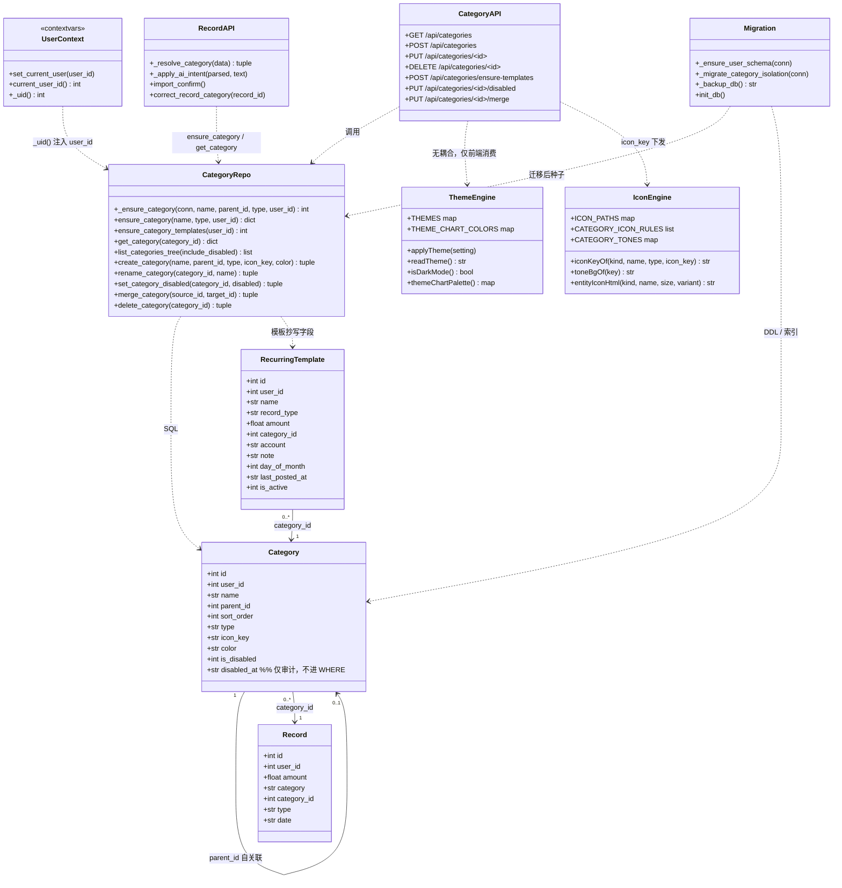
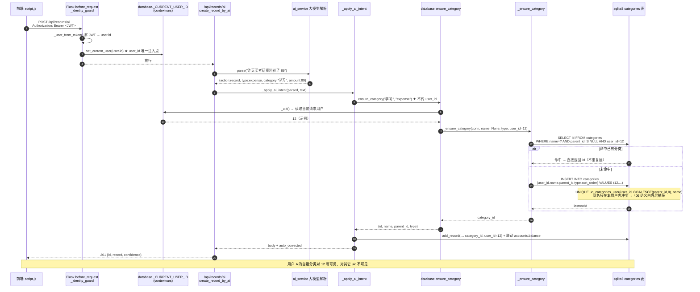
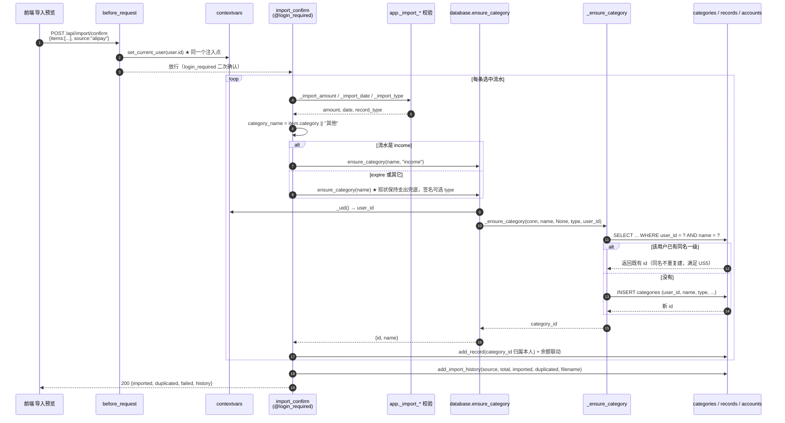
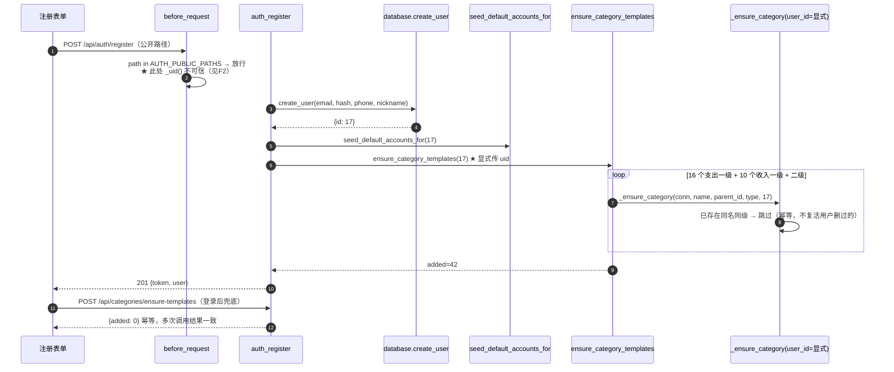
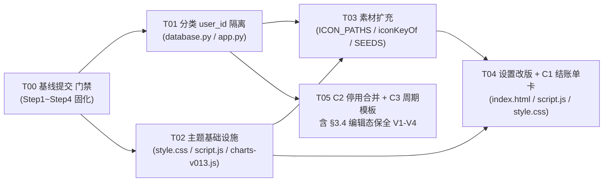

# AI 记账管家 · v0.13.1-DEV 增量系统设计

> 作者：高见远（架构师） ｜ 输入：`docs/HANDOFF.md` + `docs/prd-v0131.md` + 现有代码
> 基线：v0.13.0-DEV + 工作区未提交改动（categories.type、_seed_income_categories、头像隔离目录、`#new-category-type`、资产折叠、「我的」等高）
> 本文只做设计，不含实现代码。

---

## 1. 实现方案与关键取舍

| # | 决策点 | 决定（一句话） |
|---|---|---|
| D1 | 分类隔离数据模型（Q1） | **改造现有 `categories` 表加 `user_id`**，不新建「模板表 + 用户分类表」——后者要重挂所有 `records.category_id`，风险高一个量级 |
| D2 | user_id 注入层 | **统一注入在 `database.py` 的 `_uid()`（contextvars）**，app.py 全链路零签名改动；只有「注册补齐」这种不在用户上下文里的场景才显式传 `user_id` |
| D3 | 迁移块位置 | 新增 `_migrate_category_isolation(conn)`，放在 `init_db()` 里 **`_ensure_user_schema()` 之后、第二段 DML 之前**（`database.py:1130` 与 `:1132` 之间） |
| D4 | 唯一索引改造（A2） | 顺序写死：`CREATE UNIQUE INDEX IF NOT EXISTS uq_categories_user (user_id, COALESCE(parent_id,0), name)` → 成功后再 `DROP INDEX IF EXISTS uq_categories`；两步各自 try/except，drop 失败只告警不回滚整段迁移 |
| D5 | 种子归属 | `_ensure_category / _seed_categories / _seed_income_categories / _backfill_category_ids` **全部改为接收显式 `user_id`**，`None` 才回落 `_uid()`；`init_db()` 启动段固定传 `ADMIN_USER_ID=1`，保持老用户 1 号的分类体系不动（Q2→①） |
| D6 | 新用户模板（A5/A6，Q3→③） | 注册成功时 `ensure_category_templates(user_id)` 一次补齐；前端登录后再调 `POST /api/categories/ensure-templates` 幂等兜底，失败静默不影响主流程 |
| D7 | 主题钩子（关键新增约束） | `[data-theme]` **只做变量命名空间**（每套主题一块），另加 `data-mode="light\|dark"` **作为组件级深浅钩子**；把现有 63 处 `[data-theme="dark"] .xxx` 组件覆盖整体改写成 `[data-mode="dark"] .xxx` |
| D8 | 主题持久化（Q5） | localStorage 只存**设置值**（light/dark/amber/mint/violet/midnight/oled/system），存的不是解析结果；旧值 light/dark/system 天然兼容，`system` 仍映射到 `light`/`dark` |
| D9 | 图表配色（B10） | 单一真源 `window.themeChartPalette()`：**4 处硬编码同时改**（`PIE_COLORS`→函数、`chartPalette()`、`trendOption()` 三色、`charts-v013.js` `SERIES_META`），返回体新增 `dark: true/false` 布尔，废弃 `charts-v013.js:264` 用颜色反推深色的写法 |
| D10 | 图标匹配（B4） | `iconKeyOf()` 重写：显式 icon_key → 整名相等 → **关键词按长度降序**包含匹配 → 按 `type` 回落（`income`→`salary`，`expense`→`more`） |
| D11 | 周期账单（C3，Q7→①） | **只做提醒 + 手动一键生成**，禁止任何后台定时/自动写账单与改余额 |
| D12 | 分类合并（C2，Q10→②） | 迁移账单后**停用（is_disabled=1）保留**，不物理删除；源分类下线、账单全部指向目标分类 |
| D15 | 基线提交门禁 | **团队「Step1~Step4 精准基线提交」是 T01 的前置依赖**，未提交前任何人不得动 `index.html` / `script.js` / `style.css` / `app.py` / `database.py` 的同一处（热点：`templates/index.html:1598` `#new-category-type`） |
| D16 | 停用语义（P0 硬约束） | **「停用」≠「消失」**：`is_disabled` 只是「不允许新选」，分类行本身永不被过滤出「编辑态」；见 §3.4 专节 |
| D17 | 主题钩子改造方式（**U1 已拍板**） | 引入 `data-mode="light\|dark"` 作为组件钩子，`data-theme` 仍只做变量命名空间；**63 处组件覆盖必须脚本化替换 + 计数校验回滚**，禁止手改、禁止在项目目录留脚本 |
| D18 | C2b 编辑态口径（**team-lead 拍板**） | 编辑态走**前端用 record 自带字段临时补 option**，**不给列表 API 加 `include_disabled`**；`include_disabled` 只允许出现在「分类管理（停用项管理区）」一种场景，见 §3.4 |
| D19 | 时间/金额外的第三类引用完整性 | 架构级规则：**凡被 `records` 引用着的实体（分类 / 账户），API 一律停用保留、禁止物理删除，且历史记录中的引用值必须可回读** |
| D13 | DB 迁移安全 | 每次迁移前 `shutil.copy2` 备份 `records.db` 到 `D:\Project\temp\db-backup\records.db.bak-<时间戳>`（遵守「测试产物不进项目目录」），备份失败即中止迁移 |
| D14 | 依赖策略 | **零新增第三方包**，pandas/openpyxl/PyJWT/ECharts 已够用；新 JS 全部写进现有 `script.js` / `charts-v013.js`，不引新 <script> |

---

## 2. 文件清单

| 文件 | 改动位置（现状行号） | 改动概要 |
|---|---|---|
| `database.py` | `DB_PATH` 附近、:15-22 `CATEGORY_SEEDS`、:528 `INCOME_CATEGORY_SEEDS` | 扩充 16 个支出一级 + 10 个收入一级种子；新增 `CATEGORY_SEED_ORDER` 保证追加顺序稳定 |
| `database.py` | :494 `_row_to_category`、:505 `_ensure_category` | 行字典增加 `icon_key/color/is_disabled/user_id`；`_ensure_category` 加 `user_id` 形参，全部 SQL 带 `user_id` |
| `database.py` | :531 `_seed_categories`、:539 `_seed_income_categories` | 加 `user_id` 形参；抽出 `ensure_category_templates(user_id)`（幂等、返回补齐条数） |
| `database.py` | :573 `_backfill_category_ids` | 按 `SELECT DISTINCT user_id FROM records` 逐用户回填，杜绝 A 用户 generates 到 1 号名下 |
| `database.py` | **新增** `_migrate_category_isolation`（放在 :614 之前或 :1148 之后作为独立函数，被调用点在 :1130 之后） | A1/A2/A4 迁移 + `icon_key/color/is_disabled/disabled_at` 幂等补列 + `recurring_templates` 建表 + 迁移前备份 |
| `database.py` | :795 `init_db()` | 在第一段 DDL 的 `CREATE TABLE categories`(:915) 里补齐 `user_id/type` 列定义（双保险）；调用 `_migrate_category_isolation` |
| `database.py` | :1158 `get_category`、:1170 `ensure_category`、:1185 `list_categories_tree`、:1211 `create_category`、:1260 `rename_category`、:1300 `delete_category`、:1331 `reorder_categories`、:1366 `get_all_categories` | 全部加 `WHERE user_id = ?`；`create_category` 校验父级同 user；**`list_categories_tree(include_disabled=False)`**：默认过滤 `is_disabled=0`，`include_disabled=True` 才全量返回（编辑态专用）；行字典必带 `is_disabled`；新增 `set_category_disabled / merge_category` 与 `recurring_templates` CRUD |
| `app.py` | :330 注册路由 | `create_user` 后调 `ensure_category_templates(user["id"])` |
| `app.py` | :2304-2374 分类路由区 | 新增 `POST /api/categories/ensure-templates`、`PUT /api/categories/<id>/disabled`、`PUT /api/categories/<id>/merge`；**GET `/api/categories` 支持 `?include_disabled=1`**；PUT 改名路由支持 `icon_key/color` |
| `static/script.js` | **:760 `fillCategoryParent`、:820 `selectedCategoryId`、:872 `renderCategoryGrid`、:1103 `loadCategories`、:4737 `fillRecordForm`** | **P0 编辑态保全改造**（§3.4）：按 D18 **不用 `include_disabled`**，改为 `fillRecordForm` 用 record 自带 `category_id / category / category_parent` **零请求合成临时 option** 注入 `#category` / `#sub-category`（index.html:987/993）；另需停用的 5 处 UI + 1 处排序见 §3.4 表 |
| `static/style.css` | :7 `:root`、:60 `[data-theme="dark"]`、**63 处组件级 `[data-theme="dark"]`**、以及所有 `@media (prefers-color-scheme: dark)` | 变量块按主题扩到 6 套；**组件块由 `D:\Project\temp\patch_v0131_css_datamode.py` 脚本化替换为 `[data-mode="dark"]`**（含计数校验与失败回滚）；同步梳理 `@media (prefers-color-scheme: dark)`，确保媒体查询只负责给「未选定主题的首次访问」兜底，选定后不再与属性钩子打架 |
| `database.py` | :1841 `_RECORD_SELECT` | 追加 `c.parent_id AS category_parent_id`（**D18 的前置补丁**，见 §3.4 缺口分析），使 record 自带父级 id，编辑态回填无需任何额外请求 |
| `app.py` | :2022 `import_confirm` | 无逻辑改动（user_id 由 `_ensure_category` 的 `_uid()` 自动注入），仅确认 `ensure_category("其他")` 兜底仍生效 |
| `app.py` | 末段（分类路由之后） | 新增 `/api/recurring-templates` 四个 CRUD 路由 |
| `static/script.js` | :44 `PIE_COLORS`、:2465 `isDarkMode`、:2470 `chartPalette`、:2615/:2654、:2693 `trendOption` | `PIE_COLORS` → `pieColors()`；新增 `THEMES`/`THEME_CHART_COLORS`/`themeChartPalette()`；`chartPalette()` 改为消费主题色并补 `brand/colors/dark`；`trendOption` 三色取主题色 |
| `static/script.js` | :5356 `applyTheme`、:5389 `toggleTheme`、:5347 `readTheme`、:2279 单选 Change、:1761/:1783 重置 | 支持 7 值；同时写 `data-theme` 与 `data-mode`；切换后触发首屏 + 图表页双重复绘 |
| `static/script.js` | :6487 `ICON_PATHS`、:6511 `CATEGORY_ICON_RULES`、:6529 `CATEGORY_TONES`、:6541 `iconKeyOf`、:6552 `iconToneOf`、:6570 `entityIconHtml` | 图标扩到 40+；规则表加长度分级；新增 `toneBgOf()`（深色用 rgba 主色 0.16）；`iconKeyOf` 重写；`entityIconHtml` 圆底改主题感知 |
| `static/script.js` | :1688 `HOME_CARD_OPTIONS`、>=8600 渲染区 | 追加 `home-monthly-card`（C1）；新增 `renderMonthlyCard()` 纯前端渲染；分类树行末加「合并/停用」入口（C2）；首页顶部「本月待记」条（C3） |
| `static/charts-v013.js` | :20 `SERIES_META`、:241 `trendOption`、:264 `chartDark`、:643 MutationObserver | `SERIES_META` 改为取 `window.themeChartPalette()`；`chartDark` 改读 `palette.dark`；`data-theme` 属性监听保留（同步 documentElement 变化即可触发） |
| `static/style.css` | :7 `:root`、:60 `[data-theme="dark"]` | 新增 5 个 `[data-theme="amber\|mint\|violet\|midnight\|oled"]` 变量块；`:root` 保留作为 light 默认；新增 `[data-mode="dark"]` 空钩子声明位置注释 |
| `static/style.css` | 全局 63 处 `[data-theme="dark"] .xxx` 组件覆盖（:2188 ~ :9385） | **整体改写为 `[data-mode="dark"] .xxx`**（含 :8189 图标选择器块、:9268 分类网格块等 v0.13.0 新代码） |
| `static/style.css` | :7161 `.theme-choice/.theme-option` 之后（文件末尾） | 新增 `.theme-swatch-grid/.theme-swatch/.is-active`（B12 色卡网格）、`.monthly-card*` （C1）、`.merge-*`（C2）、`.recurring-*`（C3）；按「同权重靠末尾覆盖」纪律追加 |
| `templates/index.html` | :8 `<meta name="theme-color">`、:1241-1244 主题区、:1592-1604 分类管理弹窗 | meta 由 JS 同步；三个 radio → `#theme-swatches` 容器；分类弹窗加「图标」按钮 + `#icon-picker-modal`；新增 `#home-monthly-card` 容器与「本月待记」条 |
| `manifest.json` | :`theme_color` | 静态值无法被前端改写（见「待明确 U3」），本期保持 `#2563eb` 不动，B11 只落地 meta 同步 |
| `docs/dev-log.md`、`docs/prompts/` | 末尾 | 封版时补 v0.13.1 技术路径 3-5 句与 Prompt 快照（HANDOFF 红线 6） |

---

## 3. 数据结构变更

### 3.1 `categories` 表：迁移前 → 迁移后

| 项 | 迁移前 | 迁移后 | 说明 |
|---|---|---|---|
| 列 | `id, name, parent_id, sort_order, user_id(由 _ensure_user_schema 补), type(未提交改动补)` | `id, **user_id** NOT NULL DEFAULT 1, name, parent_id, sort_order, type NOT NULL DEFAULT 'expense', **icon_key** TEXT DEFAULT '', **color** TEXT DEFAULT '', **is_disabled** INTEGER NOT NULL DEFAULT 0, **disabled_at** TEXT` | 三个新列均为可空/有默认值的幂等 ALTER，重复执行不报错 |
| 唯一索引 | `uq_categories (COALESCE(parent_id,0), name)` | **`uq_categories_user (user_id, COALESCE(parent_id,0), name)`**，`uq_categories` 已 DROP | 两名 Differentiating：SQLite 不支持 ALTER INDEX，只能新建后删旧 |
| 普通索引 | `idx_categories_user (user_id)` | 保留不变 | A1 已由现有 `_ensure_user_schema` 完成 |
| 数据 | 32 行全 `user_id=1` | 老数据不动；新用户的模板行独立插入 | Q9→① 允许跨用户同名 |

### 3.2 新增 `recurring_templates`（C3）

| 列 | 类型 | 说明 |
|---|---|---|
| `id` | INTEGER PK AUTOINCREMENT | |
| `user_id` | INTEGER NOT NULL DEFAULT 1 | 隔离 |
| `name / record_type / amount / category_id / account / note` | TEXT / TEXT / REAL / INTEGER / TEXT / TEXT | 与 records 字段命名保持一致 |
| `day_of_month` | INTEGER NOT NULL DEFAULT 1 | 1-28，避免月末溢出 |
| `last_posted_at` | TEXT DEFAULT '' | 上次手动生成日期，前端判断「本月待记」 |
| `is_active` | INTEGER NOT NULL DEFAULT 1 | 停用不等于删除 |
| `created_at` | TEXT DEFAULT CURRENT_TIMESTAMP | |

### 3.3 迁移步骤（严格顺序，幂等）

| 步 | 语句 | 失败处理 |
|---|---|---|
| 0 | `shutil.copy2(DB_PATH, backup)` | 抛错即中止 |
| 1 | PRAGMA 判断表存在，不存在直接 return | — |
| 2 | `ALTER TABLE categories ADD COLUMN user_id INTEGER NOT NULL DEFAULT 1`（幂等保护） | 已存在则跳过 |
| 3 | `UPDATE categories SET user_id=1 WHERE user_id IS NULL OR user_id<=0` | — |
| 4 | `CREATE INDEX IF NOT EXISTS idx_categories_user (user_id)` | — |
| 5 | `ALTER TABLE categories ADD COLUMN type TEXT NOT NULL DEFAULT 'expense'` + 回填 | 已存在则跳过 |
| 6 | `ALTER TABLE categories ADD COLUMN icon_key TEXT DEFAULT ''` / `color TEXT DEFAULT ''` / `is_disabled INTEGER NOT NULL DEFAULT 0` / `disabled_at TEXT` | 逐列先查 `PRAGMA table_info` 再 ALTER，已存在则跳过 |
| 7 | **`CREATE UNIQUE INDEX IF NOT EXISTS uq_categories_user (user_id, COALESCE(parent_id,0), name)`** | 失败即中止（有脏同名数据需人工处理，告警到 stdout） |
| 8 | **`DROP INDEX IF EXISTS uq_categories`** | 失败仅告警，不影响已生效的新索引 |
| 9 | `CREATE TABLE IF NOT EXISTS recurring_templates (...)` + `CREATE INDEX idx_recurring_user` | — |

### 3.4 停用语义专节（P0 硬约束：「停用」≠「消失」）

#### 字段选型结论：新增 `is_disabled`，**不复用 `deleted_at`**

| 维度 | 结论 |
|---|---|
| 事实前提 | 经核对 **`categories` 表当前没有 `deleted_at` 列**（列集：`id, name, parent_id, sort_order, user_id, type`），只有 `records` 有。因此 HANDOFF 的 `WHERE user_id = ? AND deleted_at IS NULL` 契约**只约束 records 系查询，与 categories 无冲突可谈** |
| 语义差异 | `records.deleted_at` 是**时间戳型**「进回收站」，可被 purge；分类停用是**布尔开关**，可逆且仍被历史账单引用。两者同名会造成「同一个词两种语义」的长期歧义 |
| 决策 | 新增 `is_disabled INTEGER NOT NULL DEFAULT 0` 作为**唯一判定列**；`disabled_at TEXT` 仅作审计留痕（何时停用），**不参与任何 WHERE 判定** |
| 禁止事项 | 禁止给 categories 加 `deleted_at`；禁止让 `list_categories_tree` 因停用而返回「条目缺失」而非「条目带标记」 |

#### 编辑态丢数据：已核实的完整损坏链（比「被置空」更严重）

```mermaid
sequenceDiagram
    autonumber
    participant U as 用户
    participant FRM as openRecordModal / resetRecordForm
    participant API as GET /api/categories
    participant FILL as fillRecordForm:4737
    participant FIND as findCategory:734
    participant GRID as renderCategoryGrid:872
    participant SEL as selectedCategoryId:820
    participant PUT as PUT /api/records/&lt;id&gt;
    U->>FRM: 打开一笔归属「点外卖」的旧账单（该分类已停用）
    FRM->>FRM: fillCategoryParent(null) 重建 #category，无 placeholder
    Note over FRM: select.value = "null" 匹配不到任何 option<br/>浏览器自动停在【第一个 option】
    FRM->>FILL: 继续填表
    FILL->>FIND: findCategory(record.category_id)
    API-->>FIND: 默认响应里已排除停用项
    FIND-->>FILL: null（★ 静默跳过整个 if(found) 分支）
    FILL->>GRID: renderCategoryGrid()
    GRID-->>U: 网格里没有「点外卖」这一格
    Note over U,GRID: 用户此时未点任何格子
    U->>SEL: 点「保存修改」
    SEL-->>PUT: category_id = 列表第一个分类的 id<br/>（不是 null，是【错的那个】）
    PUT-->>U: 200 已保存修改
    Note over U,PUT: ✗ 静默数据损坏：<br/>旧账单分类被改写成一个完全不相干的别的分类，<br/>用户无任何感知、后端无任何报错
```

**关键结论（三条）**：
1. **展示层确实是安全的**（`categoryLabel():1080` 读 record 自带的 `category` / `category_parent` 字符串，不查分类表）——但正因为列表看起来完好无损，用户更不会察觉编辑态已经被改写。
2. **损坏不是「被清空」而是「被替换成列表第一项」**：`#category` 这个 `<select>` 没有占位 option，`select.value = "null"` 赋值失败后浏览器保留首项，于是 `selectedCategoryId():829` 拿到的是**别人的分类 id**。这是比空值更隐蔽的形态。
3. **第 4 条配套检查点的答案：PUT 已经是全量覆盖式，且这正是风险来源**。`collectRecordValues():4133` 每次都从 DOM 全量快照；`app.py:2200` `update_record` 的 docstring 明写「整条覆盖式更新」，`_parse_record()` 用请求体重建全部字段、`update_record()` 收 12 个位置参数。因此**不存在「少传字段被置空」的风险，反而是「DOM 当前值即真相」**——一旦 DOM 里的 select 停在错的那一格，保存必然写入错的分类。所以「把停用项渲染回网格」不是优化，是**必须的前置修复**。
4. **补充可实现性前提（好消息）**：`delete_category()`(:1317-1323) 已经拒绝删除「还有账目在用」的分类，因此**被 records 引用着的分类永远不可能被物理删除**，只要 `is_disabled` 语义成立，record 上的引用值就一定可回读。D19 的架构级规则在后端已有半边的基础。

#### 给前端的三条后端契约（应工程师 寇豆码 提问，本节为唯一权威口径）

| # | 问题 | 定稿口径 |
|---|---|---|
| Q1 | `/api/categories` 对停用项的口径 | **默认排除**（`WHERE user_id=? AND is_disabled=0`），列表语义保持干净。`include_disabled` **不作为通用开关暴露**：仅在**分类管理弹窗的「已停用」管理区**允许 `?include_disabled=1`（合并/恢复要去选那些源分类），且返回节点必带 `is_disabled` 标记。**编辑态（记账弹窗、批量改分类）禁止使用该参数**，一律走下面的 Q2/D18 零请求方案 |
| Q2 | PUT `/api/records/<id>` 能否写回已停用的 `category_id` | **允许，且必须允许。** 规格写死：**`get_category()`(:1158) 的 WHERE 只校验 `id` + `user_id`，绝不加 `is_disabled = 0`**（这是最容易写错的一行）；`_ensure_category` 在通过文本回填时也**不校验停用**。**「停用」只影响「新增场景的选项可见性」，不影响「历史账单的引用写入」。** 若此处加了停用过滤，你「注入临时 option」的兜底会被后端打回，整条硬约束当场落空 |
| Q3 | `/api/categories/merge` 是否需要返回源分类 id 清单 | **需要。** 定稿响应：`{target_id, source_id, migrated_records, disabled_source_ids: [..], categories: <最新树>}`；前端合并后**直接用响应里的 `categories` 整体覆盖 `state.categories`**，不要用旧的四消费点各自增量拼接（1103 / POST 4210 / DELETE 4239 / order 1214 四处容易残留脏状态） |

#### D18：编辑态实现口径（team-lead 已拍板）——零请求临时 option

不引入 `state.allCategories`，不新增请求。`fillRecordForm()`(:4718) 用 record 自带字段直接合成 option 注入两个隐藏 select（`index.html:987` `#category` / `:993` `#sub-category`）：

| 场景 | 数据源 | 处理 |
|---|---|---|
| 一级分类被停用 | `record.category_id` + `record.category` | 往 `#category` **头部**插入 `<option value=category_id>category</option>`，`#sub-category` 保持空 |
| 二级分类被停用、父级仍在启用 | `record.category_id` + `record.category` + `record.category_parent` | 父级从 `state.categories` 按名取到 id 正常选中；往 `#sub-category` 插入临时 option |
| 二级分类被停用、**父级也被停用** | 同上 + **`category_parent_id`（新增字段）** | 父级 id 从 record 自带字段直接拿（见下方 F12），**这是唯一需要后端配合的一行补丁** |

> **给 `#category` 加 `<option value="">请选择</option>` 占位**，并在 `fillCategoryParent()` 里保证非编辑态不会停在无效值上 —— 这是消灭「选项消失被浏览器静默吞成默认值」这条结构性成因的根治手段（对应 §3.4 第 2 条结论）。

#### 需要过滤停用项的 UI（共 5 处 + 1 处排序，采纳工程师清单）

| # | 位置 | 说明 |
|---|---|---|
| ① | `renderCategoryGrid()`(:872) 记账弹窗一级网格 | 新增场景不显示停用项 |
| ② | `openCategoryFlyout()`(:954) 二级浮层 | 同上 |
| ③ | 批量改分类弹窗（`index.html:844`） | 同上 |
| ④ | `renderCategoryTree()`(:1126) 分类管理树 | **反向**：此处必须**显示**停用项（管理区），加「已停用」角标 + 恢复按钮 |
| ⑤ | `#new-category-parent`（`loadCategories` :1111-1119）新建分类的父级下拉 | 必须过滤，否则可以往停用父分类下继续建子分类 |
| ＋ | `/api/categories/order`(:1214) 拖拽排序 | 排序集合排除停用项，避免拖完顺序串台 |

#### 四条硬约束的落地规格

| # | 约束 | 落地位置 | 规格 |
|---|---|---|---|
| 1 | schema 表达停用态 | `database.py` 迁移第 6 步 | `is_disabled INTEGER NOT NULL DEFAULT 0` + `disabled_at TEXT`；**不新增 `deleted_at`**；`is_disabled` 是唯一判定列 |
| 2 | 列表默认排除 + **受限**开关 | `database.py:1185 list_categories_tree(include_disabled=False)` → `app.py` GET `/api/categories` | 默认 `WHERE user_id=? AND is_disabled=0`；`?include_disabled=1` **仅限分类管理弹窗的停用管理区**（见 Q1）。开关名全链路统一为 `include_disabled` |
| 3 | 编辑态必须渲染出旧分类且可选中 | **前端：`fillRecordForm()`(:4718) 触发，`fillCategoryParent()`(:760) / `fillCategoryChild()`(:779) 注入临时 option，`renderCategoryGrid()`(:872) 渲染并打 `.is-disabled` 角标** | **按 D18 走零请求合成，不用 API 开关**；`#category` 必须带占位 option；回填后调 `syncCategoryGridSelection()`(:917) 把 `is-active` 打到旧分类上；临时 option 打 `.is-disabled` + 「已停用」标记，**仍可点击选中** |
| 4 | 只有显式点击才允许改分类 | `renderCategoryGrid()` + `syncCategoryGridSelection()`(:917) + `selectedCategoryId()`(:820) | 维持「点击只切 `.is-active`、不重建 DOM」纪律；未触碰时 `selectedCategoryId()` 原样返回旧 id → PUT 原样提交。**验收用例：打开旧账单直接保存，PUT body 的 `category_id` 必须等于原值**（V4） |

> 上面四条同时作为 **T05 的验收前置条件**（见 §5），缺失任何一条即判定 T05 未完成。

### 3.5 核心数据结构与服务类（Mermaid）



---

## 4. 程序调用流程

### 4.1 场景一：AI 记账时自动创建分类（user_id 在哪一层注入）



**要点**：AI 链路本身**零改动**——`app.py:1031` 的 `ensure_category(category, type)` 保持签名不变，隔离由 DB 层 `_uid()` 兜住。

---

### 4.2 场景二：CSV/Excel 导入时创建分类



**要点**：`app.py:2053` 一行不改。导入产生的分类自动落在本用户下；`except RecordError → ensure_category("其他")` 兜底同样带 user_id。

---

### 4.3 注册补齐默认分类（唯一需要显式传 user_id 的链路）



---

## 5. 任务列表（按依赖顺序）

> 回归风险列的数字均为「现有 v0.13.0 自测脚本覆盖面」带来的既有脆弱点，实现时优先自测这几处。
> **T00 是全组门禁**：`templates/index.html:1598` 的 `#new-category-type` 目前未提交，是已知冲突源。
> **T01~T05 全部以 T00 为前置**：T01/T02 直连 T00，T03~T05 经 T01/T02 传递依赖。**基线落地前任何人不得改动任何文件**（此刻 QA 正在真实 Chrome 跑 Step4 回归，动文件会污染断言）。

| 任务 | 描述 | 涉及文件 | 前置依赖 | 可能的回归风险（按严重度） |
|---|---|---|---|---|
| **T00** | **基线提交（门禁，非编码）**：把 Step1~Step4 的既有增量固化成一个 commit —— categories.`type` + `_seed_income_categories` + `_save_avatar_image`/`_delete_avatar_file` + `#new-category-type` + 资产账户折叠 + 「我的」卡片等高 + `docs/prd-v0131.md`。提交后所有人统一从该 commit 起开工 | 工作区全部已修改文件 | —（**必须先于 T01**） | ① 漏提交某块增量导致后续 code review 分不清「基线」与「新做」；② 未先行提交就并行开工 → 三方改同一处 DOM 需手工合流；③ 建议提交前 `.venv` 外全部 `git status` 逐项确认 |
| **T01** | **分类 user_id 隔离（地基）+ 隔离相关安全必修**：A1/A2/A3/A4/A5/A6 —— `_migrate_category_isolation()`（含迁移前备份）、9 个分类查询函数加 `WHERE user_id=?`、`_ensure_category` 显式 uid、种子扩形参、`ensure_category_templates()`、`POST /api/categories/ensure-templates`、注册链路补齐、隔离回归脚本；**并必修 F2 / F3 / F5 / F6（安全级，不可裁剪）** | **`database.py`**：`CATEGORY_SEEDS`:15-22、`INCOME_CATEGORY_SEEDS`:528、`_row_to_category`:494、`_ensure_category`:505、`_seed_categories`:531、`_seed_income_categories`:539、`_backfill_category_ids`:573、**`set_current_user`:86-92（F2 修复点）**、`_ensure_user_schema`:614、**`init_db`:795 与 `CREATE TABLE categories`:915-923（F6 补 user_id/type 列定义）**、**新增 `_migrate_category_isolation`**、`get_category`:1158、`ensure_category`:1170、`list_categories_tree`:1185、**`create_category`:1211（F5 捕获 IntegrityError→409）**、`rename_category`:1260、`delete_category`:1300、`reorder_categories`:1331、`get_all_categories`:1366<br>**`app.py`**：**`_identity_guard`:201-229（F2 全部调用点）**、注册路由 :330/:351、分类路由区 :2304-2374<br>**测试**：`temp/test_v0131_iso.py` | **T00** | ① 迁移顺序反了导致新库缺 user_id 列（F6）；② 老用户 1 号分类被误删/误并（US2）；③ `uq_categories` 未成功 DROP 导致多用户同名建不了；④ `_backfill_category_ids` 把别人经理的名字建到 1 号名下；⑤ 记账弹窗 `category_id` 跨用户被拒 400；⑥ **F2 改错方向（用真值判断而非 `is None`）→ `set_current_user(0)` 仍被兜底成 1，隔离做完也是假的**；⑦ F3 遗漏：种子函数仍依赖 `_uid()`，注册补齐会写到 1 号名下；⑧ 迁移前未备份或备份写进项目目录（违反 temp 纪律） |
| **T02** | **主题基础设施（6 套 + 图表配色）**：B8/B9/B10/B12 前半 —— `THEMES` 常量表、`THEME_CHART_COLORS`、`applyTheme()` 同时写 `data-theme`/`data-mode`、`themeChartPalette()`、`PIE_COLORS`→`pieColors()`、`chartPalette()` 扩容、`trendOption()` 去硬编码、`charts-v013.js` `SERIES_META` 与 `chartDark` 改造、style.css 5 个新变量块 + **63 处 `[data-theme="dark"]` 组件覆盖改写为 `[data-mode="dark"]`** | `static/script.js`、`static/charts-v013.js`、`static/style.css`、`templates/index.html`（meta） | **T00**（避免与 T00 之后才稳定的 DOM 抢同一行） | ① **漏改那 63 处组件覆盖 → 5 套新主题下通知/账单/图标选择器/分类网格显示为浅色残留**（最高风险）；② **手改 63 处导致漏改/错位（必须脚本化 + 计数校验）**；③ `renderCharts` 未同步触发 → 图表页颜色不跟随；④ `system` 旧值兼容失效（含 `prefers-color-scheme` 变化时 `data-mode` 未跟随）；⑤ 侧栏 `--sidebar-*` 各主题取值漏配导致白字白底；⑥ **F4 未修：`palette.line === "#24334a"` 换肤当天必现失效**；⑦ `@media (prefers-color-scheme: dark)` 与属性钩子打架（两套都命中、互相覆盖） |
| **T03** | **素材扩充（图标 40+ + 匹配规则 + 默认分类种子）**：B3/B4/B5/B1/B2 —— `ICON_PATHS` 扩到 40+、`CATEGORY_ICON_RULES` 长词优先分级、`iconKeyOf()` 四级回落、`toneBgOf()` 深色 rgba、`CATEGORY_TONES` 补齐、`CATEGORY_SEEDS` 16 个一级、`INCOME_CATEGORY_SEEDS` 10 个一级 | `static/script.js`、`database.py` | T01（种子必须跑在隔离迁移之后才能验证归属）、T02（圆底浅色依赖 `palette.dark`） | ① `iconKeyOf` 规则顺序漏排 → 「其他收入」落到 `tag` 或误吃短词；② 新增种子与用户已删分类重名（Q2→① 补缺不覆盖）需真幂等；③ 反复启动 init_db 不应复活已删除分类；④ 圆底色在新主题下发灰/发白；⑤ **F8 未修：`entityIconHtml` 内联圆底色绕开 CSS 变量，深色主题下发白刺眼** |
| **T04** | **设置弹窗改版 + C1 月度结账单卡**：B12 后半（`#theme-swatches` 色卡网格替换三个 radio）+ B7（分类管理弹窗图标选择器 `#icon-picker-modal`，78px auto-fill 网格 + 搜索 + 绿色高亮选中）+ C1（`renderMonthlyCard()`：本月收/支/结余、Top5 横向条、环比、日均、单笔最大；接入 `HOME_CARD_OPTIONS` 显隐） | `templates/index.html`、`static/script.js`、`static/style.css`（末尾追加） | T02（色卡消费 THEMES）、T03（图标选择器消费 ICON_PATHS） | ① 主题单选 old DOM 事件（:2279 change）失效 → 切主题无反应；② C1 用 `state.allRecords` 时区边界导致跨月归属错；③ 分级环形记账弹窗 DOM 重建纪律被破坏（HANDOFF 已知坑）；④ 图标格子塞进父级 flex 行被压变形 |
| **T05** | **C2 分类停用 + 合并 / C3 周期账单模板**：`is_disabled` + `disabled_at` 补列、`list_categories_tree(include_disabled)` 与 `GET /api/categories?include_disabled=1`、`PUT /api/categories/<id>/disabled`、`PUT /api/categories/<id>/merge`（复用 `set_records_category` 迁移 + 迁移后停用）、**编辑态保全改造（§3.4 四条）**、`recurring_templates` CRUD 四条路由 + 资产页【周期账单】按钮 + 首页「本月待记」条 → 一键带参数打开记账弹窗（**只生成表单不自动写库**） | `database.py`、`app.py`、`templates/index.html`、`static/script.js`、`static/style.css` | T01 | ① **编辑态静默改分类（§3.4，最高优先级）**；② 合并时把他人账单迁走（迁移 UPDATE 必须带 user_id）；③ 停用分类仍被导入/批量改分选中；④ 「一键生成」误走自动记账改余额（红线，Q7）；⑤ `day_of_month` 29-31 在短月无对应日需夹到月末 |

#### T02 执行要求（data-mode 改造，U1 已拍板）

1. **必须脚本化，禁止手改。** 补丁脚本放 `D:\Project\temp\patch_v0131_css_datamode.py`（沿用既有 `patch_v013_*` 命名文化），**严禁在项目目录留下任何 `patch_*` 文件**。脚本内实现：备份 → 替换 → 计数校验 → 不合格自动回滚。
2. **双保险分工**：
   - **变量块保留 `[data-theme="..."]`**：`:root`（=light 默认）+ `[data-theme="dark"]`(:60) + 新增 `[data-theme="amber|mint|violet|midnight|oled"]`，共 7 组值；
   - **组件块全部换成 `[data-mode="dark"]`**：63 处组件级覆盖统一由属性钩子接管，与「当前是哪套深色主题」解耦。
3. **计数校验（硬门禁，不允许「差不多」）**：

| 指标 | 替换前 | 替换后目标 | 不达标处理 |
|---|---|---|---|
| `[data-theme="dark"]` 出现次数 | 64 | **3**（= 第 60 行变量块 1 处 + 该文件头部/ `@media` 处的说明性注释 2 处） | 回滚 |
| `[data-mode="dark"]` 出现次数 | 0 | **63**（严格等于被替换的组件块数量） | 回滚 |
| 注释之外的裸 `[data-theme="dark"]` 选择器 | 63 | **0** | 回滚 |
| `node --check` / 页面无 CSS 语法告警 | — | 通过 | 回滚 |

4. **`applyTheme()` 同时维护两个属性**，并处理「跟随系统」：`data-theme` 写**设置值解析后的主题名**，`data-mode` 写 `light|dark`；必须 `matchMedia("(prefers-color-scheme: dark)")` 挂 `change` 监听，系统深浅切换且当前设置= `system` 时两个属性一起更新，并触发图表重绘。
5. **`@media (prefers-color-scheme: dark)` 一并梳理**：媒体查询只允许给「用户还没选过主题的首次访问」兜底；一旦 `applyTheme` 写入 `data-mode`，后续判定一律走属性钩子，禁止两套逻辑同时命中同一条组件规则。
6. **B11 范围按 F9 写死**：本期**只同步 `<meta name="theme-color">`**（`index.html:8`）；`manifest.json` 的 `theme_color` 是静态文件、前端改不了，**不在本期范围内**，避免做无用功。

#### T05 验收前置条件（四条全绿才算完成，源自 §3.4）

| # | 验收项 | 判定方式 |
|---|---|---|
| V1 | 停用态可表达且与 `deleted_at` 无冲突 | `categories` 有 `is_disabled`/`disabled_at`、**没有** `deleted_at`；`is_disabled` 是唯一判定列 |
| V2 | 列表默认排除、显式开关可取全量 | `GET /api/categories` 默认不含停用项；`?include_disabled=1` 返回含停用项；开关名全链路统一 |
| V3 | 编辑旧账单时旧分类在网格里渲染出来且可选中 | 打开一笔归属已停用分类的旧账单 → 网格中存在该格并带 `.is-disabled`「已停用」角标，且可点击选中 |
| V4 | 未触碰分类时原样提交 | 打开旧账单**直接点保存**，抓 PUT `/api/records/<id>` 的 body，`category_id` 必须**等于原值**（关键：不是 null，也不是列表首项） |

> V4 是唯一能拦住那类静默数据损坏的断言，务必写成自动化用例而非人工核对。本报告 §3.4 已核实：PUT 是**全量覆盖式**（`app.py:2200` `update_record` docstring + `_parse_record()` 重建全字段），因此 V4 不过即等于允许数据被静默改写。

### 依赖图



---

## 6. 依赖包

**无新增。** 现有 `requirements.txt`（Flask / PyJWT / pandas / openpyxl / Werkzeug）与前端 ECharts 本地 vendor 已覆盖全部本次改动。
唯一提醒：若 T05 的周期模板要接「服务启动时定时器」——**不需要**，本期纯手动触发，因此也不引入 APScheduler。

---

## 7. 共享知识（跨文件约定）

| 类别 | 约定 |
|---|---|
| SQL 隔离 | 所有 categories / recurring_templates 查询一律 `WHERE user_id = ? AND ...`，`?` 从 `_uid()` 取；**唯一例外**是显式传入 `user_id` 的种子与注册补齐函数 |
| 种子纪律 | 全部种子「补缺不覆盖」：已存在同级同名就跳过；**用户删过的分类不会被复活**；新增一级追加到同父级 `MAX(sort_order)+1` |
| **停用 vs 删除（P0）** | ① **`is_disabled` 是 categories 唯一的停用判定列，`disabled_at` 只做审计不进 WHERE**；② **禁止给 categories 加 `deleted_at`**（避免与 records 的回收站语义同名词异义）；③ **`list_categories_tree()` 默认 `include_disabled=False`，带停用过滤是默认行为而非遗漏**；④ **任何"读分类去填表/编辑"的场景必须走 `include_disabled=True`**，包括记账弹窗、批量改分类、CSV 导入的目标下拉 |
| **state 双清单约定** | `state.categories` = 默认清单（不含停用，用于新增/选择）；`state.allCategories` = `include_disabled=1` 全量（**仅用于编辑回填与网格渲染**）。两者都由 `loadCategories()`(:1103) 一次性拉取。**禁止在渲染新增类 UI 时读 `allCategories`** |
| **编辑态保全（P0）** | 「停用的分类」在语义上必须仍可被选中。记账弹窗打开旧账单时：① `fillRecordForm()` 用 `allCategories` 定位；② `fillCategoryParent()`/`renderCategoryGrid()` 必须把旧分类渲出来并打 `.is-disabled` 角标；③ 回填后调 `syncCategoryGridSelection()` 打 `is-active`；④ **未触碰网格时 `selectedCategoryId()` 必须原样返回旧 id**。违反任一条＝允许静默数据损坏 |
| **种子禁止依赖 `_uid()`（强制，F3）** | ContextVar `default=1`，任何非请求上下文（init_db、脚本）都以 1 号身份写入。**`_ensure_category` / `_seed_categories` / `_seed_income_categories` / `ensure_category_templates` 必须显式接收 `user_id`**，只有对外的高层便利函数才允许回落到 `_uid()`。违反这条等于把新用户的分类种到管理员名下 |
| **`set_current_user` 兜底语义（强制，F2）** | 只有 `None` / 非法值才兜底到 `ADMIN_USER_ID`；**`0` 必须保持 `0`**。实现上用 `if user_id is None:` 判断，**禁止用 `user_id or ADMIN_USER_ID` 真值判断**（`0 or 1 == 1`）。受影响调用点：`database.py:86-92` 定义处、`app.py:216/221/225/228` |
| **C2b 编辑态口径（强制，D18）** | 编辑态**不给列表 API 加 `include_disabled`**，一律前端用 record 自带 `category_id / category / category_parent / category_parent_id` **零请求合成临时 option** 注入 `#category` / `#sub-category`。`include_disabled` 只允许出现在分类管理弹窗的「已停用」管理区。禁止工程师自行发明相反的 API 设计 |
| **引用完整性（架构级，D19）** | 凡被 `records` 引用着的实体（分类 / 账户），API **一律停用保留、禁止物理删除**，且历史记录中的引用值必须可回读。对应后端硬要求：**`get_category()` / `_ensure_category()` 的 WHERE 只校验 id + user_id，**绝不加 `is_disabled = 0`**——停用只影响「新增场景的选项可见性」，不影响「历史账单的引用写入」 |
| **`<select>` 必须有占位 option** | 结构性根因是「选项消失被浏览器静默吞成默认值」。凡动态重建的 `<select>`（尤其 `#category`）必须带 `<option value="">请选择</option>`，并在重建后显式赋值与校验；禁止依赖浏览器默认选中第一项 |
| **B11 范围（已写死）** | 本期**只做 `<meta name="theme-color">` 同步**。PWA manifest 的 `theme_color` 是静态 JSON，前端改不了，**不在范围内** |
| **补丁脚本纪律** | 行级批量改动一律用 `D://Project//temp//patch_v0131_*.py`，**项目目录不得留脚本**；脚本自带备份 + 计数校验 + 失败回滚；改动后在 `D://Project//temp//index.md` 补索引 |
| **全量覆盖式 PUT** | `PUT /api/records/<id>` 是**整条覆盖式**（`app.py:2200`），前端每次从 DOM 全量快照后提交。因此 DOM 里 select 的当前值就是真相——**不存在「少传字段被置空」，但存在「DOM 停在错值就写入错值」**。任何影响 `#category` / `#sub-category` 选中态的改动都必须连带验证该 PUT 的 body |
| 幂等 | 所有 ALTER/建索引前先 `PRAGMA table_info` / `sqlite_master` 判断；整个 `init_db()` 必须能连续跑 3 次不报错且结果一致 |
| 迁移顺序 | `_ensure_user_schema()` → **`_migrate_category_isolation()`** → 第二段 DML 种子。**不可调换** |
| 事务 | SQLite DDL 会隐式提交，故迁移独占一个 `with conn:` 块；索引 DROP 失败只告警不回滚 |
| 前端主题 | `<html data-theme="light\|dark\|amber\|mint\|violet\|midnight\|oled" data-mode="light\|dark">`；`data-theme` 用于变量取值，`data-mode` 用于组件级特例，**两者由 `applyTheme()` 一次性写入**；CSS 中禁止再新增 `[data-theme="xxx"] .yyy` 形式的组件覆盖 |
| CSS 变量 | 沿用现有 `--` 短横线小写前缀（如 `--brand-blue`）；每套主题必须给全 HANDOFF/PRD「六、1」列出的全部变量，缺一个都可能出现白底白字 |
| localStorage key | 统一 `ai-accounting-*` 前缀。主题沿用 `ai-accounting-theme`；新增 `ai-accounting-recurring-collapse`（若有）、`ai-accounting-monthly-card`（C1 折叠态，可选） |
| 图表取色 | 全站唯一入口 `window.themeChartPalette()` → `{dark, text, strong, line, surface, brand, colors:[12]}`；**任何 ECharts 颜色不得再硬编码**，包括 `charts-v013.js` 的 `SERIES_META` 与 `script.js` 的 `trendOption` |
| 深色判定 | JS 侧只用 `themeChartPalette().dark` 或 `data-mode === "dark"`；**禁止**再用「颜色等于某十六进制」反推深色（现状 `charts-v013.js:264` 的写法要删） |
| API 返回 | 分类节点新增字段一律可空兼容：`icon_key: ""`、`color: ""`、`is_disabled: 0`、`disabled_at: ""`；老前端不读这几个字段也不会坏 |
| 错误语义 | 同名冲突 409（含「已存在」字样，现有 app.py 靠 `in` 判断状态码，新文案必须保留这四个字）；跨用户/父级不存在 400；查无此分类 404 |
| UI 纪律 | 全中文文案、禁用 `alert()` 走 Toast/ConfirmAction；新增 CSS 一律追加到 `style.css` **文件末尾**（同权重末尾覆盖）；分类网格点击只切 `.is-active` 不重建 DOM |
| 测试产物 | 测试脚本、DB 备份、截图全部落 `D:\Project\temp`，并在 `temp/index.md` 建索引，禁止写进项目目录 |

---

## 8. 待明确事项

| # | 事项 | 影响 | 建议（未拍板） |
|---|---|---|---|
| U1 | ✅**已拍板（team-lead，2026-10-31）** —— **63 处 `[data-theme="dark"]` 组件覆盖的改写方式**：批量替换成 `[data-mode="dark"]`（推荐，一次改完），还是每个选择器写 4 个 dark 主题值（不可维护） | 决定 T02 工作量与后续所有新主题的接入成本 | **采纳 data-mode 方案**，见 §5「T02 执行要求」：脚本化替换 + 计数校验（残留 3 / 新增 63）+ 失败回滚；PM 与需求方均未识别到此前置 |
| U2 | `set_current_user(0)` 实际兜底成 1（`int(user_id or ADMIN_USER_ID)`），公开路径以 1 号身份跑 DB 查询 | 注册/登录期间的任意分类/账户查询会读到管理员数据 | 顺手修：`None` 才兜底，`0` 保持 0（可作为 T01 附带项，也可单独 mini 任务） |
| U3 | `manifest.json` 的 `theme_color` 是静态文件，前端 JS 改不了 | B11 只能做到同步 `<meta name="theme-color">` | 本期只做 meta；manifest 保持 `#2563eb`，PWA 图标色差可接受 |
| U4 | 分类合并（C2）时二级分类要不要一起并过去 | 决定 `merge_category` 的递归策略 | 只并账单、二级保持挂在源分类下（源停用后前端隐藏），实现最简 |
| U5 | 「同步默认分类」按钮的入口位置 | 影响 index.html 改动面 | 放分类管理弹窗底部，与「添加」同行，不新增页面 |
| U6 | 图标数量 40+ 是否全部手写 SVG path | T03 工作量最大项 | 优先 24 个高频 key（PRD 五已列全），剩余用 `tag`/`more` 兜底，避免为凑数画坏图 |
| U7 | 现有 32 行老分类（含自定义的「卫浴」「二分」等）是否要在 UI 上标记归属 | 低 | 不改，1 号管理员视角下与现状完全一致 |

---

## 附：本设计识别出的、PM 约束清单之外的关键技术约束

| # | 发现 | 出处 | 处理建议 |
|---|---|---|---|
| F1 | style.css 里 `[data-theme="dark"]` 出现 **64 次**，其中只有 1 次是变量块（:60），**其余 63 次是组件级覆盖**。新增 5 套主题后，这 63 处规则全部失效 → 深色主题下通知/账单/图标选择器/分类网格会保留浅色样式 | `static/style.css:2188~9385` | U1 的 `[data-mode]` 方案 |
| F2 | `set_current_user(0)` 被 `int(user_id or ADMIN_USER_ID)` 兜底成 1，公开路径实际以管理员身份访问 DB | `database.py:89`、`app.py:221/225` | U2 |
| F3 | `_CURRENT_USER_ID` ContextVar **default=1**，任何非请求上下文（init_db 种子、脚本）都以 1 号身份写入 | `database.py:77` | D5：种子必须显式传 uid |
| F4 | `charts-v013.js:264` 用 `palette.line === "#24334a"` 反推深色 → 换肤当天即失效 | `static/charts-v013.js:264` | D9：改读 `palette.dark` |
| F5 | `_ensure_category` 是「SELECT 后 INSERT」，两个 uq 索引之间的窗口内并发同名会抛 `IntegrityError`（500 而非 409） | `database.py:505-524` | 现状单进程可接受；建议 T01 顺手在 `create_category` 里捕获 IntegrityError 转 409 |
| F6 | `CREATE TABLE categories`（:915）定义里**没有 user_id / type 列**，全靠 `_ensure_user_schema` 补。若将来有人调整调用顺序，新库会缺列 | `database.py:915-923` | 在 CREATE 语句里直接补齐两列定义做双保险，同时迁移仍做幂等 ALTER |
| F7 | `iconKeyOf()` 现有实现是「规则表顺序 + indexOf 首个命中」，既没有长度优先、也没有 type 回落；新增「收入/其他」这类兜底词后必然误吃（现已有长度倒挂个案：如「日用红包」→购物而非礼物） | `static/script.js:6541-6550` | D10 |
| F8 | `entityIconHtml()` 把圆底浅色（如 `#fff1e6`）写死在内联 style，深色主题下发白刺眼，且绕开了 CSS 变量 | `static/script.js:6570-6584`、`CATEGORY_TONES:6529` | 新增 `toneBgOf()`：`palette.dark` 时返回 `rgba(主色, .16)` |
| F9 | `manifest.json` 的 theme_color 无法被前端改写，PRD B11 描述有歧义 | `manifest.json` | U3 |
| F10 | **编辑态静默数据损坏链（P0）**：`#category` 这个 select 在 `fillCategoryParent(null)` 里被重建且**没有 placeholder option**，赋值 `"null"` 失败后浏览器保留**第一个 option**；叠加 `findCategory` 找不到已停用分类时静默跳过整个 `if(found)` 分支 → 打开旧账单直接保存会把分类改写成列表首项，全程无报错 | `script.js:760-772 / :820-831 / :872-912 / :4737-4747` + `app.py:2200 update_record`（整条覆盖式） | §3.4 四条硬约束 + T05 的 V1~V4 验收；配套 §3.4双清单约定（`state.categories` / `state.allCategories`） |
| F12 | **`_RECORD_SELECT`(:1841-1851) 只返回 `p.name AS category_parent`（名字），不带父级 id** → 当「二级分类与其父级同时被停用」时，父级既不在 `state.categories`、record 上又没有它的 id，工程师的零请求临时 option 方案会**拿不到父级 id 而无法回填 `#category`** | 实测：SQL 里确无 `parent_id` 别称；`grep category_parent` 全项目仅 3 处消费 | T05 前置补丁：给 `_RECORD_SELECT` 追加 `c.parent_id AS category_parent_id`（纯增量字段，零行为变更），三种场景即可全覆盖且仍零请求 |
| F11 | `categories` 表现有列集里**没有 `deleted_at`**，HANDOFF 的软删除契约只约束 records | 实库 `PRAGMA table_info(categories)` 实测结果 | 停用走 `is_disabled`，不复用 `deleted_at`，从根上避开两套同名异义软删除 |
