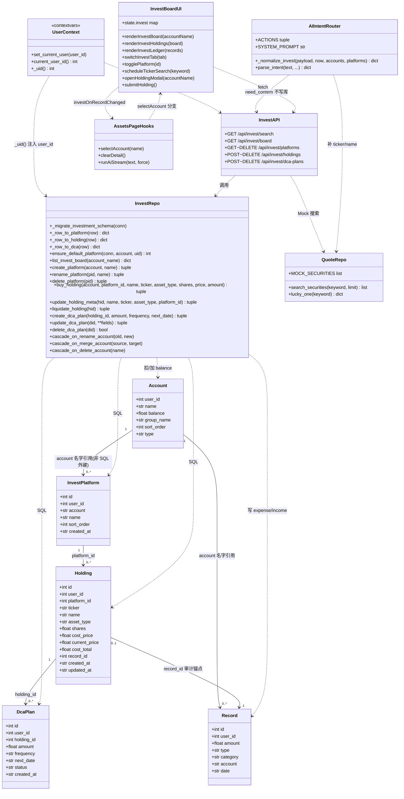
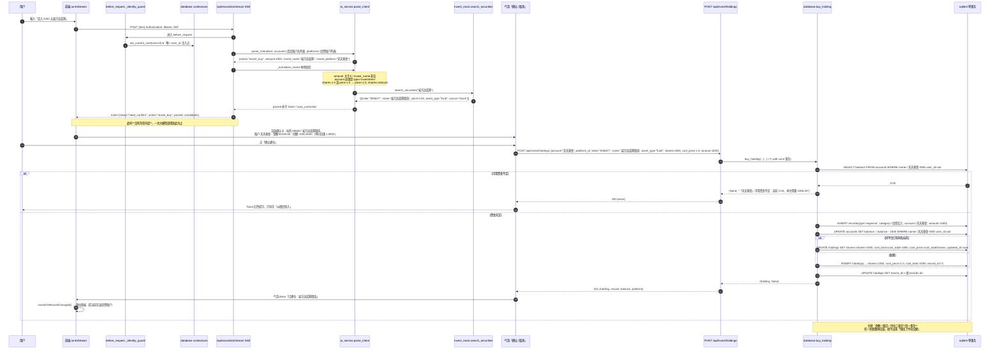
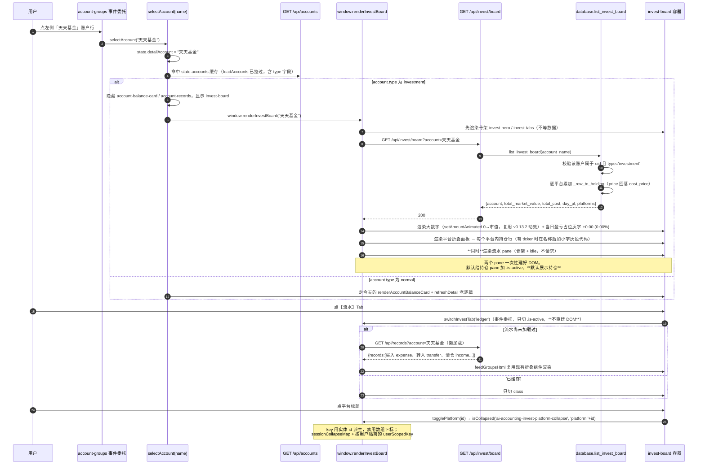
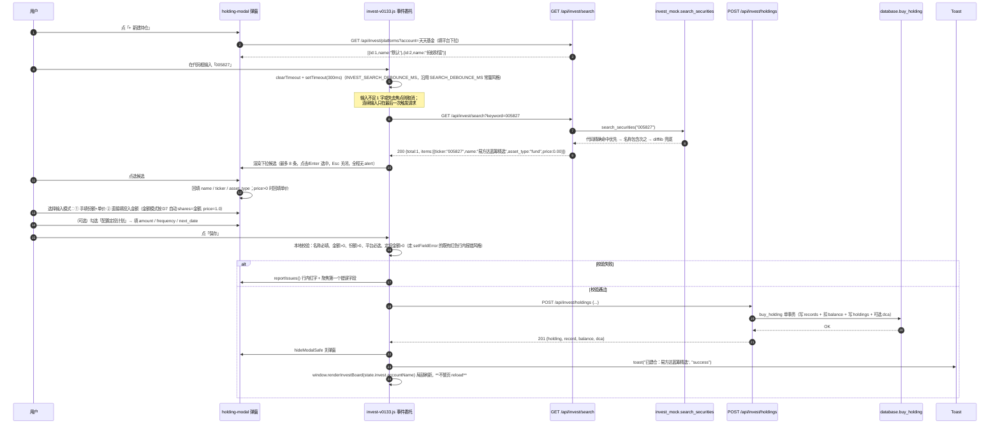
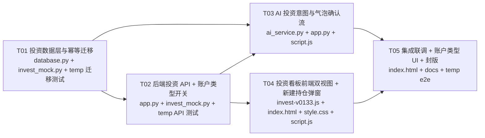

# AI 记账管家 · v0.13.3-DEV 增量系统设计
## 投资账户体系、双视图看板与 AI 深度适配

> 作者：高见远（架构师） ｜ 输入：`docs/HANDOFF.md` + 用户原始需求 Step 2 / 3 / 4 + 现有代码实测
> 基线：v0.13.1-DEV（已打 tag）+ 工作区 v0.13.2 前端体验优化改动（静态资源版本串现状为 `?v=0.13.3`）
> 本文只做设计，不含实现代码。实测结论均来自本机 `records.db` 与源码核对，行号为**当前工作区**行号。

---

## 1. 实现方案与关键取舍

### 1.1 为什么不用任何新框架

| 现实约束 | 结论 |
|---|---|
| 无 npm、无构建链（``（**放在 script.js 之后**） |
| `static/invest-v0133.js` | **新增** | 看板渲染、双 Tab、平台折叠、防抖搜索、建仓提交、事件委托；对外只暴露 `window.renderInvestBoard / window.investOnAccountsChanged / window.investOnRecordChanged` |
| `static/script.js` | `:688 state`、`selectAccount():1976`、`clearDetail():1967`、`runAiStream():10339` 的 done 分支、`switchPage():6043` | 新增 `state.invest`（含 `activeTab` 会话态）；`selectAccount` 加 type 判定分支；气泡新增 `need_confirm` 处理分支；**合计 ≤ 40 行**，其余全部在新文件里 |
| `static/style.css` | **文件末尾追加** | `.invest-*` 全部新样式（双 Tab、大数字、平台折叠、持仓行、搜索下拉、盈亏占位灰字），含 `[data-mode="dark"]` 深色适配（沿用 v0.13.1 `data-mode` 钩子纪律） |
| `docs/dev-log.md`、`docs/prompts/39-v0133-invest-board.md`、`docs/HANDOFF.md` | 末尾 / 新增 / 第 19、五段 | 封版必做（HANDOFF 红线 3、6） |
| `temp/test_v0133_migration.py`、`temp/test_v0133_api.py` | **新增（禁止进项目目录）** | 幂等迁移验证 + API 契约回归；并在 `temp/index.md` 补索引 |

---

## 3. 数据结构与接口

### 3.1 `accounts` 表：新增 `type` 列

| 项 | 迁移前 | 迁移后 | 说明 |
|---|---|---|---|
| 主键 | `(user_id, name)` | 不变 | **本期不给 accounts 加 id 列**（见 U1） |
| 新增列 | — | `type TEXT NOT NULL DEFAULT 'normal'` | 取值 `'normal'`（默认）/ `'investment'`；应用层白名单校验，无 CHECK |
| 索引 | — | **不建** | `type` 基数只有 2，`(user_id, name)` 已能覆盖所有查询，加索引纯属负收益 |
| 数据影响 | 全部行 `type='normal'` | 仅 `group_name='投资账户'` 的行在**首次补列时**被回填为 `'investment'` | 其它账户 UI 行为与今天完全一致 |

### 3.2 `invest_platforms`（投资子账户，账户 → 平台 一对多）

| 列 | 类型 | 约束 | 说明 |
|---|---|---|---|
| `id` | INTEGER PK AUTOINCREMENT | | |
| `user_id` | INTEGER | `NOT NULL DEFAULT 1` | 隔离；与 `accounts.user_id` 同义，非 SQL 外键 |
| `account` | TEXT | `NOT NULL` | **账户名**（不是 account_id，见 U1）。与 `accounts.name` 同口径，`rename_account` 必须级联 |
| `name` | TEXT | `NOT NULL` | 平台名，如「蚂蚁财富」「天天基金」「默认」 |
| `sort_order` | INTEGER | `NOT NULL DEFAULT 0` | 折叠面板排序，新平台追加到末尾（同 Categories） |
| `created_at` | TEXT | `DEFAULT CURRENT_TIMESTAMP` | |

索引：`idx_ip_user (user_id)`、`idx_ip_user_account (user_id, account)`、**唯一** `uq_ip_user_account_name (user_id, account, name)`（同一投资账户下平台名不得重复 → 409）。

> **为什么 `account` 而不是 `account_id`**：实测 `accounts` 表结构为 `(user_id, name, balance, group_name, sort_order)` + `PRIMARY KEY (user_id, name)`，**不存在任何单列 id**。全项目引用账户一律用名字（`records.account / records.to_account / debts.account`）。用名字引用可复用现有 `rename_account / merge_account / delete_account` 的级联改写模式（它们本来就遍历同名字段），零重建表风险。见 U1。

### 3.3 `holdings`（持仓）

| 列 | 类型 | 约束 | 说明 |
|---|---|---|---|
| `id` | INTEGER PK AUTOINCREMENT | | |
| `user_id` | INTEGER | `NOT NULL DEFAULT 1` | 隔离 |
| `platform_id` | INTEGER | `NOT NULL REFERENCES invest_platforms(id)` |外键**只声明不强制**（项目从未 `PRAGMA foreign_keys=ON`，与 `records.category_id` 同风格），靠应用层按 `user_id` 校验 |
| `ticker` | TEXT | `NOT NULL DEFAULT ''` | 代码，可空；**有值时前端必须在名称后用小字灰显** |
| `name` | TEXT | `NOT NULL` | 标的名称 |
| `asset_type` | TEXT | `NOT NULL DEFAULT 'fund'` | `fund/stock/bond/cash/other` 白名单，非法值回落 `'fund'` |
| `shares` | REAL | `NOT NULL DEFAULT 0` | 份额，**round 4 位** |
| `cost_price` | REAL | `NOT NULL DEFAULT 0` | 加权平均单价，**round 4 位** |
| `current_price` | REAL | `NOT NULL DEFAULT 0` | **0 = 未接行情**；读取时回落 `cost_price`（D8） |
| `cost_total` | REAL | `NOT NULL DEFAULT 0` | 累计投入成本（= 历史所有买入 records 金额之和，round 2），用于展示与回滚 |
| `record_id` | INTEGER | 可空 | 最近一笔买入关联的 `records.id`（审计锚点，不用于回滚） |
| `created_at` / `updated_at` | TEXT | `DEFAULT CURRENT_TIMESTAMP` | |

索引：`idx_h_user (user_id)`、`idx_h_user_platform (user_id, platform_id)`、**唯一** `uq_h_user_platform_name (user_id, platform_id, name)`（同平台同名 = 加仓，不得新建 → 409/加仓分支）。

> **唯一性为什么锚在 `name` 而不是 `ticker`**：手填持仓（定投计划、现金理财）常常没有 ticker，用 `COALESCE(ticker,'')` 建唯一索引会让「多个无代码持仓」互相冲突。名称是唯一必须存在的字段，用它做业务唯一键最稳。

### 3.4 `dca_plans`（定投计划，本期只落库不执行）

| 列 | 类型 | 约束 | 说明 |
|---|---|---|---|
| `id` | INTEGER PK AUTOINCREMENT | | |
| `user_id` | INTEGER | `NOT NULL DEFAULT 1` | |
| `holding_id` | INTEGER | `NOT NULL REFERENCES holdings(id)` | 所属持仓 |
| `amount` | REAL | `NOT NULL DEFAULT 0` | 每期金额，round 2 |
| `frequency` | TEXT | `NOT NULL DEFAULT 'monthly'` | `weekly/biweekly/monthly/quarterly` 白名单 |
| `next_date` | TEXT | `NOT NULL DEFAULT ''` | `YYYY-MM-DD`；空串表示尚未排期 |
| `status` | TEXT | `NOT NULL DEFAULT 'active'` | `active/paused`；**不使用 `deleted_at`** |
| `created_at` | TEXT | `DEFAULT CURRENT_TIMESTAMP` | |

索引：`idx_dca_user (user_id)`、`idx_dca_user_holding (user_id, holding_id)`、`idx_dca_user_next (user_id, next_date)`（未来「本月待投」提醒用）。

### 3.5 迁移步骤（严格顺序，幂等，共 10 步）

> 范式完全对齐 v0.13.1 的 `_migrate_category_isolation`：先备份 → 判列 → 补列 → 回填 → 建新索引 → 建表 → 补种子。

| 步 | 语句 / 动作 | 幂等保护 | 失败处理 |
|---|---|---|---|
| 0 | `_backup_db()`（**复用现有函数**，进程级单例 `_MIGRATION_BACKUP_FILE`，同一进程只拷一次，不会堆出第二个备份） | 已备份则复用 | 抛 `RuntimeError` **整体中止**（沿用现有纪律：宁可启动失败也不裸奔改表） |
| 1 | `PRAGMA table_info(accounts)`；无 `type` 则 `ALTER TABLE accounts ADD COLUMN type TEXT NOT NULL DEFAULT 'normal'` | 列存在则跳过 | — |
| 2 | **仅当步 1 真的补了列**：`UPDATE accounts SET type='investment' WHERE group_name='投资账户'` | 由 `accounts_need_type` 标志控制，二次启动绝不执行 | — |
| 3 | `UPDATE accounts SET type='normal' WHERE type IS NULL OR type NOT IN ('normal','investment')` | 每次可执行，成本极低 | — |
| 4 | 明确**不建** `type` 索引 | — | — |
| 5 | `CREATE TABLE IF NOT EXISTS invest_platforms (...)` | IF NOT EXISTS | — |
| 6 | `CREATE INDEX IF NOT EXISTS idx_ip_user / idx_ip_user_account`；`CREATE UNIQUE INDEX IF NOT EXISTS uq_ip_user_account_name` | IF NOT EXISTS | **唯一索引失败即中止**（同 v0.13.1 步 7：库里有同名脏数据需人工处理） |
| 7 | `CREATE TABLE IF NOT EXISTS holdings (...)` + `idx_h_user / idx_h_user_platform` + `CREATE UNIQUE INDEX IF NOT EXISTS uq_h_user_platform_name` | 同上 | 同上，失败即中止 |
| 8 | `CREATE TABLE IF NOT EXISTS dca_plans (...)` + 三个普通索引 | IF NOT EXISTS | — |
| 9 | `INSERT OR IGNORE INTO invest_platforms (user_id, account, name, sort_order)` —— 给每个 `type='investment'` 的账户补一个名为「默认」的子平台 | INSERT OR IGNORE + 唯一索引双保险，重复执行行数不增长 | — |
| 10 | 打印一行 `[v0.13.3] 投资体系迁移完成：platforms=N` | 纯日志 | — |

**「不改坏旧数据」的四道保障**：

1. **DDL 全部带判断**：补列前 `PRAGMA table_info`；建表/建索引一律 `IF NOT EXISTS`；`ALTER TABLE ... ADD COLUMN` 带非空默认值 → 已有行自动填 `DEFAULT`，一行都不会丢（项目已反复验证过这个套路）。
2. **三张新表不参与任何既有 SQL**：`records / categories / accounts / debts / contacts` 的所有查询一行未改；唯一变化是 `list_accounts()` 的返回字典多一个 `type` 键（前端不读也不坏，符合「新增字段一律可空兼容」纪律）。
3. **既有表零结构变更**：不改 `records`（不新增列），不动 `accounts` 主键，不重建任何表。
4. **可重复执行验证方案**（`temp/test_v0133_migration.py`，见 §7 T01）：
   - 连续调用 `init_db()` **3 次**，不抛任何异常；
   - `PRAGMA table_info(accounts)` 中 `type` **恰好出现 1 次**（防重复补列）；
   - `SELECT COUNT(*) FROM accounts` 与 `SUM(balance)` 三次执行**完全相等**；
   - `SELECT COUNT(*) FROM invest_platforms / holdings / dca_plans` 三次执行**不增长**（步 9 幂等）；
   - 手工把某投资账户的 `type` 改成 `'normal'` → 重启 App（第二次启动）后**必须仍是 `'normal'`**（验证步 2 只在首次执行）；
   - `D:\Project\temp\db-backup` 目录在一次启动中**只新增 1 个**备份文件。

### 3.6 AI 意图（`ai_service.py`）字段扩展

`ACTIONS` 增加 `'invest_buy'`。SYSTEM_PROMPT 的字段契约从 **16 个扩到 21 个**（新增 5 个投资专用字段）：

| 新字段 | 类型 | 用途 |
|---|---|---|
| `invest_name` | 字符串 | 标的名称（「易方达蓝筹」「沪深300ETF」） |
| `invest_ticker` | 字符串 | 代码（模型能给就给，给不出留空，由后端 Mock 搜索补） |
| `invest_shares` | 数字 | 份额；没有留 0 |
| `invest_platform` | 字符串 | 子平台名（「天天基金」）；没有留空，后端落到该账户的「默认」平台 |
| `invest_price` | 数字 | 单价（用户没提就 0，后端按 D7 回落 1.0000） |

> **落地要求**：SYSTEM_PROMPT 里明写「字段键名固定为下面 **21** 个」，并把这句同步到所有示例 JSON（add_contact / unknown 的示例也要补齐 5 个留空字段），否则模型会学到「可以少给字段」。模型漏字段由 `_as_text() / _as_amount()` 兜底，不会崩（见 U7）。，Prompt 里「16 个」改为「21 个」并在 Task §1 说明。）

**归一化 `_normalize_invest(payload, now, accounts, platforms)`**：
- `amount` 走现有 `_as_amount()`，`<= 0` 直接 `AIServiceError`（与 record 分支一致）；
- `invest_name` 必填（空则抛「识别成买入，但没有提取到标的名称」）；
- `account` 走现有 `_match_account()` 模糊纠错（自动纠正「天添基金」→「天天基金」），**并要求它必须是 `type='investment'`**；AI 没给或给错类型 → 回落到「当前用户第一个投资账户」，一个都没有则抛「还没有投资账户，请先在账户管理里把某个账户设为投资账户」；
- `invest_shares <= 0` 且 `invest_price > 0` → `shares = round(amount / price, 4)`；`shares <= 0` 且 `price <= 0` → 按 D7：`price = 1.0`、`shares = amount`；
- `invest_ticker` 为空时，后端调 `search_securities(invest_name)` 取第一条命中补 `ticker` 与 `name`；
- 返回体必须带 `confidence / auto_corrected / auto_corrected_msg`，结构与其他 action 对齐，才能让现有 `runAiStream` 无感复用。

**余额联动 / 写库路径**：`invest_buy` **不在 `_apply_ai_intent` 里直接写库**。后端只推 `need_confirm` 事件（含 `candidates`），用户点确认后走 `POST /api/invest/holdings` —— 与手动建仓**同一条落库路径**（D10），杜绝「AI 一套逻辑、手动一套逻辑」导致的余额漂移。

### 3.7 完整 API 契约清单

> 统一约定：全部路径落在 `/api/invest/*`（**不进 `ACCESS_PROTECTED_PREFIXES`**，属用户端数据）；全部挂 `@login_required`；全部由 `_uid()` 做 user_id 隔离（`before_request` 已注入，数据库层零签名改动，见 v0.13.1 D2）。错误响应沿用现有风格 `{"error": "<中文>"}`。

| # | 路径 | 方法 | 请求体 / Query | 成功响应 | 错误码 | 校验要点 |
|---|---|---|---|---|---|---|
| 1 | `/api/invest/search` | GET | `?keyword=易方达&limit=10` | `200 {total, items:[{ticker,name,asset_type,price,source:"mock"}]}` | 400 keyword 空串 / 超 50 字 | `price` 恒为 mock 值；**未命中返回 `{total:0, items:[]}` 而不是 404** |
| 2 | `/api/invest/board` | GET | `?account=天天基金` | `200 {account:{name,type,balance,cash_label:"可用资金"}, total_market_value, total_cost, day_pl:{amount:0,percent:0,available:false}, platforms:[{id,name,market_value,holdings:[<holding>]}]}` | 400 缺 account；404 账户不存在；**400 该账户不是投资账户**（`"「天天基金」不是投资账户，请先在账户管理里切换账户类型"`） | 一次请求拿全持仓 Tab 全部数据；`platforms` 按 `sort_order, id` |
| 3 | `/api/invest/platforms` | GET | `?account=天天基金` | `200 {platforms:[{id,name,holding_count,market_value}]}` | 400 缺 account / 非投资账户 | 给「新建持仓」弹窗的下拉用 |
| 4 | `/api/invest/platforms` | POST | `{account, name}` | `201 {id,user_id,account,name,sort_order,created_at}` | 400 参数非法/非投资账户；**409 同名已存在** | `name` trim 后 ≤ 20 字；自动 `sort_order = MAX+1` |
| 5 | `/api/invest/platforms/<int:pid>` | PUT | `{name}` | `200 <platform>` | 404 不存在；409 同名 | 改名同步由唯一索引兜底 |
| 6 | `/api/invest/platforms/<int:pid>` | DELETE | — | `200 {deleted:pid}` | 404；**409 平台下还有持仓**（`"该平台下还有 N 个持仓，请先清仓"`） | 删空平台不涉及任何 money，安全 |
| 7 | `/api/invest/holdings` | POST | `{account, platform_id?, ticker?, name, asset_type?, shares?, cost_price?, amount?, dca?:{amount, frequency, next_date}}` | `201 {holding, platform, dca\|null, record:{id,amount,type:'expense',category:'投资买入'}, balance:<最新可用资金>}` | 400 参数非法 / 非投资账户 / **可用资金不足**（`"「天天基金」可用资金不足：当前 0.00，本次需要 1000.00"`）；404 平台不存在；409 同平台同名（**引导走加仓语义，但本期 API 不做隐式加仓，返回 409 让前端明确提示**） | **核心写入口**：单次事务内完成「写 records(expense) → 扣 accounts.balance → 写/更新 holdings → 可选写 dca_plans」，任一步失败整体回滚 |
| 8 | `/api/invest/holdings/<int:hid>` | PUT | `{name?, ticker?, asset_type?, platform_id?}` | `200 <holding>` | 400 参数非法；404 不存在 | **禁止改 `shares / cost_price`**（更正见 U5）；涉及金额的一律「清仓后重建」 |
| 9 | `/api/invest/holdings/<int:hid>` | DELETE | — | `200 {deleted:hid, refunded:<金额>, record:{id,type:'income'}, balance:<最新可用资金>}` | 404 不存在 | **清仓撤销**：单事务「写 records(income,'投资理财') → 加 balance → 删 holdings → 该持仓的 dca_plans 全部置 `paused`」 |
| 10 | `/api/invest/dca-plans` | POST | `{holding_id, amount, frequency, next_date}` | `201 <dca>` | 400 参数非法/频率非法；404 持仓不存在 | `amount > 0`；`next_date` 空串合法 |
| 11 | `/api/invest/dca-plans/<int:did>` | PUT | `{amount?, frequency?, next_date?, status?}` | `200 <dca>` | 400 / 404 | `status ∈ ('active','paused')` |
| 12 | `/api/invest/dca-plans/<int:did>` | DELETE | — | `200 {deleted:did}` | 404 | 物理删除计划行（计划不牵涉任何 balance，可删） |

**受影响的既有契约（零破坏式扩展）**：

| 路径 | 变化 | 兼容性 |
|---|---|---|
| `GET /api/accounts` | 账户字典新增 `type` 键 | 老前端不读不坏 |
| `POST /api/accounts` | body 新增可选 `type` | 不传 = `'normal'`，行为不变 |
| `PUT /api/accounts/<name>` | body 新增可选 `type`；切到 `'investment'` 时**自动补「默认」子平台**（幂等） | 现有「至少传 new_name/balance/group_name 之一」校验要放开成四个之一 |
| `GET /api/records?account=X` | **零改动** | 投资流水 Tab 直接复用；买入/清仓两条 `expense/income` 自然出现在里面 |
| `/api/records/ai/stream` | `invest_buy` 分支新增 `status:"need_confirm"` 事件 | 其它 action 事件序列不变，旧前端不会收到该状态 |

### 3.8 数值口径（金额/份额/单价）

| 项 | 口径 | 说明 |
|---|---|---|
| 金额（records.amount、accounts.balance、cost_total、dca.amount） | **REAL 元，`round(x, 2)`** | 与全项目一致（`database.py` 到处是 `round(...,2)`；前端 `cents()`/`money()`） |
| 份额 shares | **REAL，`round(x, 4)`** | 基金份额 3 位小数是常态，留 1 位余量 |
| 单价 cost_price / current_price | **REAL，`round(x, 4)`** | 基金净值 4 位 |
| 市值 market_value | `round(shares * price, 2)`，其中 `price = current_price > 0 ? current_price : cost_price` | **只在服务端算**（`_row_to_holding`），前端不重复实现 |
| 前端显示 | 一律 `money()` / `cents()`；**禁止 `toFixed` 之外的新造轮子** | v0.13.2 已统一千分位 |

### 3.9 核心数据结构与服务类（Mermaid）

---

## 4. 程序调用流程

### 4.1 场景一：AI 投资指令从输入到落库（含余额联动与确认）

### 4.2 场景二：打开投资看板 + 双 Tab 切换

### 4.3 场景三：新建持仓弹窗（防抖搜索 → 自动带出 → 提交）

---

## 5. 待明确事项（需 team-lead / 用户拍板）

| # | 事项 | 为什么必须明确 | 推荐答案（架构侧建议） |
|---|---|---|---|
| **U1** | **子平台如何引用投资账户**：需求原文写 `invest_platforms.account_id`，但**实测 `accounts` 表没有单列 id**（主键 `(user_id, name)`） | 选错要么要重建 accounts 表（高风险），要么 API 语义与需求文档不一致 | **推荐：列名 `account`，用账户名引用**（与 `records.account / debts.account` 全项目口径一致，零重建表风险）。若坚持要 `account_id`，必须**新增事务 T00**：RENAME accounts → 重建带 `id INTEGER PRIMARY KEY AUTOINCREMENT` 的表 → 迁移 → 重挂 accounts 的所有引用与其他派生逻辑，工作量翻倍且回归风险高 |
| **U2** | `accounts.type` 要不要 CHECK 约束 | 影响迁移写法的统一性 | **推荐：不要 CHECK。** ① SQLite 的 ALTER TABLE ADD COLUMN 对 CHECK 支持有限且不可靠；② 更关键的是会造成「新库（CREATE 带 CHECK）vs 老库（ALTER 无 CHECK）」**双形态分化**，违反幂等迁移必须让新旧库一致结构的纪律；③ 改由应用层白名单 `ACCOUNT_TYPES` 校验 + 步 3 净化兜底，与现有 `records.type`（无 CHECK）风格一致 |
| **U3** | **`invest_buy` 到底动不动 `accounts.balance`** | team-lead 点名必须在设计里给出明确答案，否则工程师必返工 | **推荐：动，且必须动。** 理由：若不扣，`accounts.balance`（已含转入的钱）+ 持仓市值会**重复计算同一笔钱**，净资产凭空翻倍。具体口径 = D5：balance 是「可用资金」，买入把它换成持仓 |
| **U4** | 买入要不要同时写 `records`？写什么 type？ | 决定数据可解释性与对统计口径的污染程度 | **推荐：写，且用现有 `type='expense'`、`category='投资买入'`**（不加第四种 type）。理由：`_balance_effects('expense')` 天然等于 `[(account, -amount)]`，**records 表零结构改动**；代价是「本月支出」会包含投资买入金额。备选「新增 `type='invest'`」需改 `RECORD_TYPES`（database.py:54 + ai_service.py:53）与前端 TYPE_LABELS / TYPE_BADGES / isTransferType / balanceSnapshots / reverseBalanceEffects / summarize / 图表过滤等约 8–10 处分叉，回归面大。**请用户认可「支出含投资」这一取舍** |
| **U5** | PUT 持仓能否改份额 / 成本 | 改了就可能出现「balance + records + holdings 三者漂移」且不可逆 | **推荐：不允许。** PUT 只允许改元信息（name/ticker/asset_type/platform_id）；涉及金额一律「清仓（DELETE）后重建」，DELETE 会对称写一条 income 并回滚 balance，账永远能对上。若产品坚持要「修改份额」，需额外设计 records 的定向修正接口（本期不建议） |
| **U6** | 同一标的多次买入：合并一行还是一笔一行 | 决定 UI 呈现与加仓算法 | **推荐：合并一行 + 加权平均成本**（`shares/cost_total/cost_price` 三件套）。这也使 UI 上「一个平台下一个标的一行」符合券商 App 直觉 |
| **U7** | AI Prompt 字段从 16 个扩到 **21 个**（新增 invest_name/ticker/shares/platform/price） | 现有 SYSTEM_PROMPT 明写「字段键名固定为下面 16 个，不得增删、不得改名」 | **推荐：接受扩展**，并在 Prompt 里明确「非 `invest_buy` 意图时这 5 个字段一律填空串/0」。模型的漏字段由 `_as_text/_as_amount` 兜底，不会崩。替代方案（把标的名塞进 `note`）会让 normalized extract 变脆，不建议 |
| **U8** | 投资「可用资金不足」时的行为 | 直接影响 AI 气泡体验 | **推荐：明确报错 + 引导先转账**（`「天天基金」可用资金不足：当前 0.00，本次需要 1000.00`），**不做**自动从其他账户代扣、不做不足额部分成交。转账本身有成熟的 transfer 意图（Step 3 的另一半需求） |
| **U9** | 投资账户的持仓市值要不要计入资产页「总净资产」 | 影响现有 `renderAssetsHero()` 与用户观感 | **推荐：本期不计入**（`总净资产 = Σ accounts.balance`，即各账户可用资金之和），但在投资账户行的副标题用灰字补一行「持仓市值 ¥x.xx」，并在看板里明确区分「可用资金 / 总市值」两个词。理由是改动最小且语义诚实；若产品要求计入，则是一笔独立改动（会牵动 `get_statistics()` 与各卡片），建议放 v0.14 |
| **U10** | DELETE 持仓的语义 | 用户可能只是「录错了想删」而不是「真的清仓赎回」 | **推荐：统一为撤销式删除**（写一条 income 回流 + 回滚 balance + 删持仓），这与「录错了想撤」是同一个资金结果，语义自洽。UI 文案用「删除持仓（资金退回可用）」，让用户一眼知道钱会回来 |
| **U11** | 投资平台是否允许直接建在账户根下（无平台） | 影响 holdings.platform_id 是否可空 | **推荐：平台必选但不必手建** —— AI/新手模式下后端自动落到该账户的「默认」平台（迁移步 9 已为每个投资账户预置），UI 里「+ 新建持仓」也可选平台。这样数据永远三层整齐，看板折叠逻辑不用写两套 |

---

## 6. 依赖包

**零新增。** 现有 `requirements.txt`（Flask / PyJWT / pandas / openpyxl / Werkzeug / openai / python-dotenv）与本地 vendor ECharts 已覆盖全部本次改动。
明确不引入：`requests`（本期不抓行情）、`APScheduler`（本期不自动执行定投）、任何前端框架/构建工具。

---

## 7. 任务列表（按依赖顺序，共 5 个）

> **交付纪律**：所有测试脚本、DB 备份、截图一律落 `D:\Project\temp` 并在 `temp/index.md` 建索引；**禁止写进项目目录**（HANDOFF 红线）。每个任务收尾必须 `py_compile` + `node --check` + 接口自测。

### **T01 — 投资数据层与幂等迁移（地基）**

- **涉及文件**：`database.py`（常量区 / `CREATE TABLE accounts` / `init_db()` / **新增 `_migrate_investment_schema`** / 账户 CRUD 级联 / **新增 `invest_*` 数据层函数区**）、`invest_mock.py`（**新建**：`MOCK_SECURITIES` 20 条 + `search_securities()` 纯函数）、`temp/test_v0133_migration.py`（**新建**）
- **改动要点**：
  1. 常量：`ACCOUNT_TYPES / INVEST_ASSET_TYPES / INVEST_BUY_CATEGORY='投资买入' / INVEST_REFUND_CATEGORY='投资理财' / INVEST_PLATFORM_DEFAULT='默认' / DCA_FREQUENCIES / DCA_STATUSES`
  2. 第一段 DDL 的 `CREATE TABLE accounts` 加 `type TEXT NOT NULL DEFAULT 'normal'` 列定义；同处补 `accounts_need_type` 标志（ ALTER 时置 True）
  3. `_migrate_investment_schema(conn)` 10 步（§3.5），挂载在 `init_db()` 的 `_migrate_category_isolation` 块之后、第二段 DML 之前
  4. 三张新表 + 索引 + 唯一索引（§3.2–3.4）
  5. 数据层函数：`_row_to_platform/_row_to_holding/_row_to_dca`（**含 D8 的 price 回落与 D9 的 day_pl 占位**）、平台 CRUD（删除前查持仓占用）、`buy_holding()`、`liquidate_holding()`、`update_holding_meta()`、`list_invest_board()`、dca CRUD
  6. **完整性级联（必做）**：`rename_account` 同步 `invest_platforms.account`；`merge_account` 迁移平台（同名则先迁移其持仓后删源平台）；`delete_account` 级联删除 platform→holdings→dca
  7. `list_accounts()` 返回值新增 `type` 键
  8. `invest_mock.py`：20 条常量（基金/股票/债券，含 005827 易方达蓝筹精选等真实代码便于测试），`search_securities()` 顺序为「代码精确 → 代码前缀 → 名称包含 → difflib 兜底」，返回体与未来真实行情完全一致（含 `source:"mock"`）
  9. `temp/test_v0133_migration.py`：**连跑 `init_db()` 3 次**的六项断言（§3.5 第 4 条），含「手工改 type 后二次启动不被覆盖」
- **依赖**：无（可最先开工）
- **优先级**：P0
- **回归风险**：① 迁移顺序放错 → 第二段 DML 里给投资账户补默认平台时表不存在；② 步 2 回填没用标志位兜住 → 每次启动覆盖用户手改的类型；③ 唯一索引失败未收敛成 RuntimeError → 静默跳过导致后面数据乱；④ 忘了给 `delete_account` 加级联 → 孤儿平台/持仓；⑤ `record_id` 在 REPO 里二次 UPDATE 忘了 → 审计锚点丢失（不影响资金）

### **T02 — 后端投资 API + 账户类型开关**

- **涉及文件**：`app.py`（新增投资接口区 + `create_account/update_account` 支持 type）、`invest_mock.py`（被路由消费，通常无需改）、`temp/test_v0133_api.py`（**新建**）
- **改动要点**：
  1. §3.7 的 12 条路由，全部 `@login_required`，错误码严格按表
  2. `POST /api/accounts` 与 `PUT /api/accounts/<name>` 支持可选 `type`（白名单校验；切到 investment 时调 `ensure_default_platform()` 幂等补平台）；放开现有「四个参数至少传一个」的校验为五个
  3. **所有跨表写操作必须由 `database.buy_holding/liquidate_holding` 承担**，路由层只做参数解析与状态码映射，禁止在 app.py 里手写第二条写库路径
  4. `temp/test_v0133_api.py`：覆盖 401 / 400 / 404 / 409 四类错误、跨用户越权返回 404（不是 400）、买入后 `balance + records.sum` 与 `holdings.cost_total` 三者勾稽、**买→删→再买**余额回到初值
- **依赖**：T01
- **优先级**：P0

### **T03 — AI 投资意图与气泡确认流**

- **涉及文件**：`ai_service.py`（`ACTIONS` / `SYSTEM_PROMPT` / `_normalize_invest` / `_normalize_intent` 分支）、`app.py`（`_apply_ai_intent` 的 invest_buy hints、`create_record_by_ai_stream` 的 `need_confirm` 事件）、`static/script.js`（`runAiStream` 的 `need_confirm` 分支 + 确认卡 UI + 取消分支，`≤ 60 行`）
- **改动要点**：
  1. Prompt 字段 16 → 21（§3.6），新增 invest_buy 意图段 + 2 条示例（「买入 1000 元易方达蓝筹」「每月定投 500 沪深300」后者仍走 invest_buy + dca 提示）
  2. `_normalize_invest()` 五步校验 + Mock 补 ticker + 投资账户归属判定
  3. **`_apply_ai_intent` 不为 invest_buy 写库**；SSE 推 `need_confirm` 后 `return`
  4. 前端确认卡：标的/代码/账户/金额/份额五要素 + 「确认建仓」「取消」两个按钮；确认走 `POST /api/invest/holdings`；取消 → 气泡「已取消建仓」并把原文塞回输入框
  5. 成功后 `investOnRecordChanged()` + 现有 `refresh()`
- **依赖**：T01（需要 `INVEST_*` 常量与投资账户判定）、建议 T02 先合（共用常量一致性）
- **优先级**：P0

### **T04 — 投资看板前端双视图 + 新建持仓弹窗**

- **涉及文件**：`static/invest-v0133.js`（**新建**）、`templates/index.html`（看板容器 + `#holding-modal` + 账户弹窗加 `#account-type` + 静态版本串 bump + 引入脚本）、`static/style.css`（**末尾追加** `.invest-*`）、`static/script.js`（`state.invest` + `selectAccount/clearDetail` 分支 + 静态引入后的三处钩子，`≤ 40 行`）
- **改动要点**：
  1. 看板容器与 `#account-balance-card / #account-records` **并列**，靠 `hidden` 属性切换，不删老 DOM
  2. 双 Tab **默认展示持仓**；切换只切 `.is-active` 不重建；流水 pane 懒加载一次
  3. 大数字走现有 `setAmountAnimated()`；当日盈亏固定渲染 `+0.00 (0.00%)` 灰字 + `title`
  4. 平台折叠面板：复用 `isCollapsed/toggleCollapseState/sessionCollapseMap/userScopedKey`，key = `platform:<id>`
  5. 持仓行：名称 + （有 ticker 时）小字灰显代码 + 右侧占位盈亏；子平台用折叠
  6. `#holding-modal`：代码搜索 300ms 防抖（≥1 字触发）、候选下拉、选中回填、份额/成本/金额双模式、可选定投区块；Enter 提交、Esc 关闭、错误走 `setFieldError` 行内红字、**全程无 alert**
  7. 样式全部 `.invest-*` 前缀，追加到 `style.css` 末尾（同权重末尾覆盖），并补 `[data-mode="dark"]` 深色适配
- **依赖**：T02（API 契约可用即可开工，可并行）
- **优先级**：P0

### **T05 — 集成联调、账户类型 UI 与封版**

- **涉及文件**：`templates/index.html`（`#account-modal` 的「账户类型」下拉接线 + 版本串终值）、`static/script.js`（新建/编辑账户表单的 type 读写，需用 `patch_*` 脚本时放 `D:\Project\temp`）、`docs/dev-log.md`、`docs/prompts/39-v0133-invest-board.md`（**新建**）、`docs/HANDOFF.md`（**仅**「当前版本」「下一步计划」段，红线 2 保护的核心规则不动）、`temp/test_v0133_e2e.py`（**新建**）
- **改动要点**：
  1. 新建/编辑账户弹窗支持切换为投资账户（切换即自动补「默认」平台），并在账户行加「投资」小角标
  2. 端到端：新建投资账户 → 从微信转入 5000 → AI「买入 1000 元易方达蓝筹」确认 → 看板市值与可用资金正确 → 切【流水】看到 transfer + expense 两条 → 删除持仓 → 可用资金回到 5000
  3. 静态资源版本串统一 bump 到 `?v=0.14.0`（现为 `?v=0.13.3`）
  4. 封版四件套：`py_compile` / `node --check` / 接口回归 / docs 更新 → commit + tag → `detect_version()` 验证
- **依赖**：T02、T03、T04
- **优先级**：P1

### 依赖图

> T01/T02 是硬性串行；**T03 与 T04 可并行（文件冲突仅在 `static/script.js` 底部，建议由 T04 先落钩子、T03 在其后追加气泡分支）**。

---

## 8. 共享知识（跨文件约定，工程师必读）

| 类别 | 约定 |
|---|---|
| **资金口径（P0）** | ① **`accounts.balance` 永远是「可用资金」，永不含持仓市值**；② 买入 = `records(type='expense', category='投资买入')` + `balance -= amount`；③ 删除持仓 = `records(type='income', category='投资理财')` + `balance += cost_total`；④ **写 records、改 balance、改 holdings 必须在同一个 `with conn:` 事务里**，任一失败整体回滚；⑤ 定投不产生任何自动写库 |
| **分类口径（P0）** | 买入固定用**支出侧** `投资买入`，清仓固定用**收入侧** `投资理财`。**不要试图两边共用同一个名字**：`uq_categories_user (user_id, COALESCE(parent_id,0), name)` **不含 type**，同名不同 type 会撞唯一约束；「投资理财」已被 `INCOME_CATEGORY_SEEDS` 占用，故买入侧另起名 |
| **user_id 隔离** | 一切投资表查询 `WHERE user_id = ?`，`?` 一律来自 `_uid()`；**跨用户访问一律返回 404（不是 400）**，禁止泄露他人资源是否存在 |
| **迁移纪律** | 补列前先 `PRAGMA table_info`；建表/建索引一律 `IF NOT EXISTS`；**迁移前先 `_backup_db()`，失败即中止**；`init_db()` 必须能连跑 3 次不报错且结果一致；`type` 的回填**只在首次补列时执行**（标志位控制） |
| **主键/引用** | `invest_platforms.account` 与 `holdings.platform_id` 分属两种引用风格是刻意的：前者按名字（沿用全项目账户引用口径），后者按 id（新表有自增主键）。**不要反过来改** |
| **数值精度** | 金额 `round(,2)`；份额/单价 `round(,4)`；市值只在服务端算并下发，**前端不做任何乘法**；金额展示一律 `money()/cents()`，沿用 v0.13.2 千分位 |
| **市值/价格口径** | `price = current_price > 0 ? current_price : cost_price`，**只在 `_row_to_holding()` 里实现一处**；`current_price` 列在未接行情时**恒存 0**（不允许把成本价写进 `current_price`，否则未来接行情时无法区分） |
| **当日盈亏占位** | 后端固定 `day_pl:{amount:0,percent:0,available:false}`；前端渲染 `+0.00 (0.00%)`。未来接入只需在 `_row_to_holding` 补 `prev_close` 与 `available:true`，**前端零改动** |
| **AI 写库唯一入口** | **只有 `POST /api/invest/holdings` 能创建持仓**（AI 确认卡、手动弹窗、未来的 CSV 导入都走它）。禁止在 `_apply_ai_intent` 里另写一条「第二条落库路径」 |
| **API 命名** | 全部 `/api/invest/*`；子资源按 REST 层级 `platforms → holdings → dca-plans`；**不进 `ACCESS_PROTECTED_PREFIXES`**（用户端数据，不是后台数据） |
| **错误语义** | 400 = 参数非法 / 余额不足 / 类型不符；401 = `auth_required`（before_request + `@login_required` 双保险）；404 = 资源不存在或不属于当前用户；409 = **文案含「已存在」或「还有 N 个持仓」**（现有 app.py 靠在字符串里找「已存在」判 409，新文案必须保留这四个字） |
| **前端 DOM 纪律** | ① 双 Tab 只切 `.is-active`，**绝不重建 pane DOM**；② 折叠 key 用实体 id 派生 `platform:<id>`，**禁用数组下标**（v0.13.1 已有下标串台事故）；③ 新增 CSS 一律追加 `style.css` **文件末尾**，前缀 `.invest-*`；④ 深色适配只写 `[data-mode="dark"]`，**不得再写 `[data-theme="dark"] .xxx` 形式的组件覆盖**（v0.13.1 U1 已拍板） |
| **交互纪律** | 全站禁用 `alert()`，统一 `toast()` / `confirmAction()`；弹窗 Enter 提交、Esc 关闭；全中文文案；表格防挤压；候选下拉最多 8 条 |
| **localStorage** | 统一 `ai-accounting-*` 前缀；本期新增 `ai-accounting-invest-platform-collapse`（折叠态），且必须过 `userScopedKey()` 做用户隔离 |
| **聊天气泡** | `invest_buy` 的 SSE 事件序列是 `thinking → extracting_amount → resolving_invest → need_confirm`（**到此不写库**），用户确认后由前端直接 POST。**`need_confirm` 不得出现在其它 action 的事件序列里** |
| **测试产物** | 脚本 / 备份 / 截图全部落 `D:\Project\temp`，`temp/index.md` 建索引，**禁止写进项目目录**；自动化用例不得盲删真实数据 |

---

## 附：本设计识别出的、需求文档之外的关键技术约束

| # | 发现 | 出处（实测） | 处理建议 |
|---|---|---|---|
| **F1** | **`accounts` 表没有单列 id**，主键是 `(user_id, name)`，因此需求里的 `invest_platforms.account_id` 在本库里无对应键 | `PRAGMA table_info(accounts)` → 仅 `user_id/name/balance/group_name/sort_order` | U1 → 改用 `account`（名字引用） |
| **F2** | **`uq_categories_user (user_id, COALESCE(parent_id,0), name)` 不含 `type`**，同名不同 type 的分类会撞唯一约束；而 `INCOME_CATEGORY_SEEDS` 里已有「投资理财」 | `database.py:988`、`database.py:587` | 买入分类另起名为「投资买入」，见 §8 分类口径 |
| **F3** | ` selectAccount()` / `renderAccountGroups()` 是资产页的**唯一热点**，投资分支插错会让「默认选中现金」「批量管理态」「行内编辑」三条既有逻辑串台 | `static/script.js:1951/1976`、事件委托 `:7962` | 投资分支只做「隐藏/显示容器 + 调 window.renderInvestBoard」，**不改动 loadAccounts 的默认选中逻辑** |
| **F4** | SSE 的 `runAiStream` 只认 terminal 状态机（`done/error/unknown/duplicate`），新增 `need_confirm` 若不 halt 会导致流结束后被当成「没有 terminal」→ 走 fallback 二次请求 | `static/script.js:10339-10420` | `need_confirm` 必须像 `duplicate` 一样 `break streamLoop` 并设置标识，且**不与 fallback 分支冲突** |
| **F5** | `delete_account` 目前只检查 records/debts 引用，**不知道投资表的存在** → 会出现孤儿 platform/holding | `database.py:1894` | T01 必须补级联删除（cascade_on_delete_account） |
| **F6** | `rename_account` 目前级联改 `records.account/to_account` 与 `debts.account`，**不含 `invest_platforms.account`** → 改个账户名，持仓就找不到了 | `database.py:1921` | T01 必须补级联改写 |
| **F7** | `_balance_effects()` 只认 expense/income/transfer 三型，**不存在第四型**，任何想「绕开 records 直接改余额」的资金变动都会撞上「任何账目变动必须联动 accounts.balance」这条红线 | `database.py:432` | 走 D5：用现成的 expense/income 承担，不扩 `_balance_effects` |
| **F8** | `_backup_db()` 是**进程级单例**，v0.13.1 与 v0.13.3 两次迁移共用同一个备份文件 | `database.py:904-921` | 可接受（同一次启动只需要一份 BASELINE 备份），但**必须在文档与日志里说清**，否则会误判「第二次迁移没备份」 |
| **F9** | 静态资源版本串现状是 `?v=0.13.3`（HANDOFF 里写的是已 bump 到 `?v=0.14.0`） | `templates/index.html:19/1875-1879` | T05 统一 bump 到 `?v=0.14.0`，避免浏览器缓存吃到旧 JS |
| **F10** | `_normalize_intent` 目前对未知 action 一律回落 `unknown`；新增 `invest_buy` 若忘记同步 `ACTIONS` 常量，模型再准也会被打成 unknown | `ai_service.py:52/798` | T03 第一步就是改 `ACTIONS`，且必须同步 `_normalize_intent` 的分支判断 |
