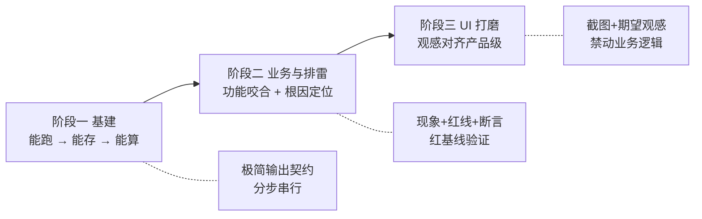

# Prompt 快照索引（docs/prompts）

> 本目录是「智汇账 / AI 记账管家」从 0 到 v0.14.0-TST 的**需求快照库**。
> 每个文件对应一次真实的开发指令，结构固定为：**需求背景 → 核心 Prompt → 方案简述 → 踩坑结论**。
> 它不是聊天记录，而是**可复盘的决策凭据**：为什么这么改、当时排掉了哪些错路、哪条约束后来变成了项目红线。

---

## 0. 阅读方式

| 你想知道 | 看哪一段 |
|---|---|
| 这个功能为什么要做 | 每个快照的「需求背景」 |
| 当时是怎么向 AI 下指令的 | 「核心 Prompt」（多数为原文，少数标注为要点摘录） |
| 落地成了什么结构 | 「方案简述」 |
| 哪些坑踩过一次就够了 | 「踩坑结论」，与 `../bugs-and-solutions/` 双向索引 |
| 怎么封版的 | `../dev-log.md` 同版本号章节 + `../HANDOFF.md` 当前版本段 |

共 **45 份快照**，按三个开发阶段归档如下。`NN` 为流水号，允许跳号（`04` 为早期实验分支，未留快照）。

---

## 阶段一 · 基建与架构（v0.01 → v0.06.4，2026-10-25 ~ 10-26）

主命题：**用最小步长把「能跑」变成「能存、能算、能看」**。这一阶段的指令几乎全部带「分步执行、只给代码、不要解释」的约束，是整个项目意图控制范式的起点。

| # | 快照 | 版本 | 核心内容 | 沉淀结论 |
|---|---|---|---|---|
| 01 | [01-flask-skeleton.md](01-flask-skeleton.md) | v0.01 | Flask 骨架、首页可访问、中文不乱码 | 确立「只给代码+运行命令+验证命令」的极简输出契约 |
| 02 | [02-memory-api.md](02-memory-api.md) | v0.02 | 内存版账目 POST/GET 接口 | 先内存后持久化，接口形状先定死 |
| 03 | [03-sqlite.md](03-sqlite.md) | v0.03 | 引入内置 `sqlite3`、自动建表 | 「重启服务数据仍在」作为持久化验收标准 |
| 05 | [05-income-accounts.md](05-income-accounts.md) | v0.03 | 收支类型、`accounts` 表、余额自动联动 | 余额是资金唯一真相；负数如实反映不静默归零 |
| 06 | [06-pc-admin-ui.md](06-pc-admin-ui.md) | v0.04 | PC 后台布局、分钟级时间、Modal 记账 | 前端与接口解耦，先 DOM 骨架后业务逻辑 |
| 07 | [07-two-level-categories.md](07-two-level-categories.md) | v0.05 | 二级分类、账户大类分组、资产页联动 | 旧数据兼容优先，先后端验证再写前端 |
| 08 | [08-transfer-calculator.md](08-transfer-calculator.md) | v0.05.1 | 转账双边记账、金额公式计算、全局 Toast | 全面禁用 `alert()`，交互规范首次成文 |
| 09 | [09-form-validation-ux.md](09-form-validation-ux.md) | v0.05.2 | 三套表单的前后端双重校验 | 校验错误就地红字，不用弹窗打断 |
| 10 | [10-pc-dashboard-refactor.md](10-pc-dashboard-refactor.md) | v0.06 | 三栏看板重构、表格防挤压 | 1440px 基准栅格，此后所有布局沿用 |
| 28 | [28-v012-multiuser-import.md](28-v012-multiuser-import.md) | v0.12 | **多用户账号系统**、JWT 鉴权、账单导入 | 架构补课：从「单用户本地库」升级为「多租户物理隔离」 |
| 29 | [29-v0121-import-auth-polish.md](29-v0121-import-auth-polish.md) | v0.12.1 | 导入入口收敛、注册安全、异常兜底 | 所有 `/api/*` 未登录统一 401 `auth_required` |

> **为什么 28/29 放在阶段一**：它们不是「新功能」，而是把前 27 个版本的单用户假设**整体替换**为多用户架构——`user_id` 过滤、JWT、`set_current_user()` 上下文。这是架构级改造，归入基建主线阅读顺序才连贯。

---

## 阶段二 · 核心业务与排雷（v0.06.2 → v0.13.8）

主命题：**功能开始互相咬合，Bug 开始藏在层与层之间**。这一阶段的快照从「要什么」转向「现象 + 约束 + 验收」，人机分工变成：人给现象与红线，AI 给定位与修复。

| # | 快照 | 版本 | 核心内容 | 沉淀结论 |
|---|---|---|---|---|
| 11 | [11-notification-center.md](11-notification-center.md) | v0.06.2 | 通知中心与开发者发布台 | 产品要有「迭代可见性」 |
| 13 | [13-white-screen-fix.md](13-white-screen-fix.md) | v0.06.4 | **白屏紧急修复**：`#net-banner` 缺闭合标签吞掉整页 | 200 响应 ≠ DOM 正确；白屏先看 DOM 树 |
| 14 | [14-notification-and-csv-fix.md](14-notification-and-csv-fix.md) | v0.07.1 | 通知富文本去黑、CSV 日期列 `####` | Excel 兼容需写文本前缀或列宽 |
| 15 | [15-ai-quick-record.md](15-ai-quick-record.md) | v0.08 | AI 一句话记账 | LLM 输出必须结构化 + 校验后再落库 |
| 16 | [16-ai-intent-reimbursement.md](16-ai-intent-reimbursement.md) | v0.08.1 | AI 意图路由、报销闭环 | 意图分类先于参数抽取 |
| 18 | [18-assets-trash-calendar.md](18-assets-trash-calendar.md) | v0.09.1 | 资产页重构、回收站、日历 | 软删除 `deleted_at` 全链路生效 |
| 19 | [19-bill-feed-assets-fab.md](19-bill-feed-assets-fab.md) | v0.09.2 | 全站账单流统一、悬浮球重构 | 三处各写一套 `<table>` 是维护灾难；浮层系统在此定型（也是 Tooltip 类问题的源头） |
| 20 | [20-v010-full-refactor.md](20-v010-full-refactor.md) | v0.10 | AI 流式解析（SSE）、PWA 骨架、全局气泡 | 长任务必须流式，否则网关超时 |
| 21 | [21-image-receipt-album.md](21-image-receipt-album.md) | v0.11 | AI 截图记账闭环、截图相册 | 图片落盘 + 删图双删，避免孤儿文件 |
| 22 | [21-v0111-pwa-access-notify.md](21-v0111-pwa-access-notify.md) | v0.11.1 | 窗口控制、图片快记、通知审核、全站访问密码 | 凭证不能只存 localStorage |
| 23 | [22-v0113-admin-gate-trend-announce.md](22-v0113-admin-gate-trend-announce.md) | v0.11.3 | 后台限定密码、三线趋势、版本号自动公告 | 访问闸门与业务登录必须分离 |
| 24 | [23-v0114-chart-ai-memory.md](23-v0114-chart-ai-memory.md) | v0.11.4 | 图表可读性、AI 置信度、Few-Shot 记忆库 | 把商户名当分类 → 用记忆库纠偏 |
| 25 | [24-v0115-ai-precision-feedback.md](24-v0115-ai-precision-feedback.md) | v0.11.5 | AI 精准识别、气泡多轮覆盖、纠错反馈中心 | 置信度交互化，低置信要求用户确认 |
| 26 | [25-v0116-account-batch-ui.md](25-v0116-account-batch-ui.md) | v0.11.6 | 账户编辑、AI 跨账户纠错、批量管理 | 批量操作必须单事务 |
| 26 | [26-v0117-ui-notify.md](26-v0117-ui-notify.md) | v0.11.7 | 纠错完整表单、Ctrl 批量、通知双时间 | 纠错要留下审计痕迹 |
| 27 | [27-v0118-search-popover-and-card-colors.md](27-v0118-search-popover-and-card-colors.md) | v0.11.8 | 全局搜索浮窗、余额卡品牌渐变 | 搜索必须跨页面可用 |
| 30 | [30-v0122-account-security-settings.md](30-v0122-account-security-settings.md) | v0.12.2 | 账号安全、设置中心 Tab 化 | 弹窗内 pane 切换只用显隐，不重建 DOM |
| 31 | [31-v0123-security-debt-icons.md](31-v0123-security-debt-icons.md) | v0.12.3 | 强密码规则、借贷强化、图标素材库 | 强密码只限注册/改密，别把管理员锁在门外 |
| 33 | [33-v0125-password-modal-icon-uid.md](33-v0125-password-modal-icon-uid.md) | v0.12.5 | 密码弹窗化、图标选择器重排、UID | `user_id` 落到 1 是越权高发点 |
| 34 | [34-v0126-handoff-icons-profile.md](34-v0126-handoff-icons-profile.md) | v0.12.6 | HANDOFF 瘦身、图标渲染、侧栏头像 | 文档必须有字数红线，否则越写越臃肿 |
| 35 | [35-v0127-icons-profile-dialog.md](35-v0127-icons-profile-dialog.md) | v0.12.7 | 专业 SVG 图标、个人中心大弹窗 | 图标格子不要塞进父级 flex 行 |
| 37 | [37-v0131-category-isolation-and-color.md](37-v0131-category-isolation-and-color.md) | v0.13.1 | **分类按 user_id 隔离、全局语义色、T05 静默篡改双清单** | 见下方「原文二」：先出红基线再修，是排雷类任务唯一可信的验收方式 |
| 39 | [39-v0133-investment.md](39-v0133-investment.md) | v0.13.3 | 投资账户体系、双视图看板、AI `invest_buy` | `(user_id, name)` 复合主键，全项目不用数字 id |
| 40 | [40-v0134-email-and-search.md](40-v0134-email-and-search.md) | v0.13.4 | 邮箱验证码落库、东财 search-api 代理 | 验证码只存哈希；外部 API 必须限速 + 降级 |
| 41 | [41-v0135-auth-and-ui.md](41-v0135-auth-and-ui.md) | v0.13.5 | 注册强校验、登录页 Glassmorphism | 注册校验与登录解耦 |
| 43 | [43-v0137-security-sidebar-pwa.md](43-v0137-security-sidebar-pwa.md) | v0.13.7 | **报销统计越权修复**、侧边栏三段式、PWA 图标 | 见下方「原文三」：跨用户泄漏一律先怀疑 SQL 缺 `user_id` |
| 44 | [44-v0137-mobile-cloudsync-pwa.md](44-v0137-mobile-cloudsync-pwa.md) | v0.13.7 | 移动端响应式、云同步强制刷新、PWA 全屏 | `display-mode` 在 headless 中恒 false，只能断言 CSS 文本 |
| 45 | [45-v0138-mobile-debt-reimburse.md](45-v0138-mobile-debt-reimburse.md) | v0.13.8 | **SW 缓存击穿**、真机安全区、借贷/报销闭环 | 缓存顽固 = `CACHE_NAME` 与 `?v=` 未同步 bump；还款/报销必须生成真实流水 |

> **关于「SW 缓存死锁」与「Tooltip 吞 title」**
> - **SW 缓存死锁**：`45` 记录了第一轮缓存击穿（`CACHE_NAME` + `?v=` 双 bump），到 v0.14.0 才查清更深一层根因——仓库里有**两份** Service Worker，`/service-worker.js` 路由指向根目录旧副本，改 `static/` 那份等于没改。结论见 `../bugs-and-solutions/05SW 双份版本号不一致导致代码不生效.md`。
> - **Tooltip 吞 title**：源头在 `19` 的浮层系统（Bootstrap Tooltip 初始化后把 `title` 搬进 `data-bs-original-title` 并缓存进 `_config.title`），完整复现与修复见 `../bugs-and-solutions/06Bootstrap Tooltip 吞掉 title 属性.md`。

---

## 阶段三 · UI 重构与体验打磨（v0.09 → v0.13.9）

主命题：**功能齐了，剩下的全是「看起来不像产品」的细节**。这一阶段的指令形态变成「现象截图 + 期望观感 + 禁止动业务逻辑」。

| # | 快照 | 版本 | 核心内容 | 沉淀结论 |
|---|---|---|---|---|
| 12 | [12-geek-interactions.md](12-geek-interactions.md) | v0.06.3 | 极客交互、系统兜底、快捷键 | 兜底必须有，但别用 `alert()` |
| 17 | [17-ui-skeleton.md](17-ui-skeleton.md) | v0.09 | 全站 5:5 骨架、「我的」页卡片统一 | Step1 只改样式不接逻辑，降低回归面 |
| 32 | [32-v0124-ui-remediation.md](32-v0124-ui-remediation.md) | v0.12.4 | UI 遗漏强制整改 | 视觉问题列清单一次性收口 |
| 36 | [36-v0130-interaction-category-charts.md](36-v0130-interaction-category-charts.md) | v0.13.0 | 可视化分类网格、图表看板、微交互 | 分类网格点击只改 `.is-active`，不重建 DOM |
| 38 | [38-v0132-frontend-experience.md](38-v0132-frontend-experience.md) | v0.13.2 | 流水默认展开、页面动效、数字滚动 | 动效首次进入才播，别每次刷新都滚 |
| 42 | [42-v0136-brand-avatar-logo.md](42-v0136-brand-avatar-logo.md) | v0.13.6 | 品牌化「智汇账」、头像 Lightbox、Logo 8 选 1 | 品牌元素集中成 token，避免各页各写一套 |

> v0.13.9（视觉重构 + Toast 重做 + 分类清洗 + 帮助反馈）与 v0.14.0-TST（总资产口径 + 快捷改余额 + 侧栏极简 + 折叠账单）属于封版冲刺，指令以「多模块合并指令」形式下发，未单独留快照，过程与验收数据见 `../dev-log.md` 对应章节与 `../bugs-and-solutions/05~09`。

---

## 一页看懂三条主线

---

## 附：三个最能体现「意图控制与 AI 协同」的 Prompt 原文

挑选标准：**约束是否可执行、验收是否可证伪、失败是否可复现**。这三条分别对应「怎么让 AI 少说废话」「怎么让 AI 找根因」「怎么让 AI 不越权」。

### 原文一 · 极简输出契约与分步串行（`01-flask-skeleton.md`）

> 「以 Python Flask 开发导师的身份带我做一个记账 Web 应用，分步走，每次只推进一小步。只给我代码、运行命令、验证命令，不要解释项目结构，也不要输出后续规划。」
>
> 「第 1 步：把 Flask 骨架搭起来，能在浏览器访问首页，中文不乱码。先能跑，再优化。」

**AI 协同反思**：这条 Prompt 没有描述任何业务，却决定了后面 45 个版本的协作形态。它同时做了三件事——**限定角色**（导师而非代笔者，意思是每一步我都要能复述）、**限定输出通道**（代码/命令/验证三件套，天然压缩冗长解释）、**限定步长**（一次一小步，出错时回归面只有一小步）。收益是双向的：AI 不必生成大段规划，token 消耗与超时风险骤降；我拿到的是可立即执行的验证命令，而不是需要二次翻译的方案。代价是速度慢、需要人多轮驱动——但这恰好是「人控方向、AI 出实现」的理想分工。这条契约后来被写进 `HANDOFF.md` 的「极简输出」红线，并演化成封版期的「后台静默写文件、聊天框禁贴全量代码」。

### 原文二 · 现象反馈驱动的根因定位（`13-white-screen-fix.md`）

> 「前端完全白屏，无 JS 异常，仅一条 PWA meta 警告。请检查 index.html 的 DOM 闭合（尤其三栏和新增弹窗）、script.js 初始化是否读了 v0.07 新增字段、style.css 是否高度坍塌；修复后自测并通过文档与 Tag 封版。」

**AI 协同反思**：这是一次「我只知道现象，不知道原因」的标准投喂。关键不在给了多少信息，而在**排除项**：明确「无 JS 异常」直接把排查空间从「脚本报错」压到「DOM 结构与布局几何」，再给出三条互斥假设（DOM 闭合 / 新字段初始化 / 高度坍塌），AI 就不必把整个前端重读一遍。它最终定位到 `#net-banner` 只有开始标签——一个 `position: fixed` 的未闭合浮层把整页 `.app` 吞成了自己的子节点。结论沉淀为一条固定排查顺序：**资源状态 → DOM 直接子节点 → 关键容器尺寸 → 初始化日志**。这条路径在后续 v0.13.9「幽灵骨架屏」上再次复用（先量几何，再怀疑 JS），一次命中。

### 原文三 · 硬约束清单与安全红线（`43-v0137-security-sidebar-pwa.md`）

> 1. 「资产页顶部四张卡（借入/借出/待报销/已报销）的统计 SQL 必须全部带上 `WHERE user_id = ? AND deleted_at IS NULL`，并校验前端明细接口，确保统计与明细口径完全一致。」
> 2. 「侧边栏品牌区独立：最顶部固定 Logo + 「智汇账」，不再显示昵称；其下横向「头像 + 昵称」，宽度不够昵称换行、极长显示省略号。」
> 3. 「PWA：manifest.json icons 指向真实 Logo，index.html head 补 apple-touch-icon，service-worker CACHE_NAME 升 v0.13.7-r1。」

**AI 协同反思**：这条 Prompt 的价值在**把「意图」翻译成了「可断言的条件」**。「统计与明细口径一致」是意图，「`WHERE user_id = ? AND deleted_at IS NULL` + 校验明细接口」是可断言条件；后者能直接变成 SQL 复核与 CDP 断言，前者只能靠人眼看。第 3 条同理：不说「把缓存清掉」，而说「`CACHE_NAME` 升到某个具体值」——因为「清缓存」无法验证，「名字变了」可以。这也是本项目所有安全类任务的写法：**授权边界写进 Prompt，而不是指望 AI 自觉**。这次修复的根因是 `get_statistics()` 的两个报销聚合漏了 `user_id`，属于后端越权，前端改多少都没用——只有「必须带 WHERE」这种硬约束，才能让 AI 去翻 SQL 而不是改 CSS。

---

## 维护约定

1. **命名**：`NN-版本-主题.md`，`NN` 递增不复用；同一版本多个补丁用 `NN-vXXXX-主题.md` 区分。
2. **必填四段**：需求背景 / 核心 Prompt / 方案简述 / 踩坑结论。缺「踩坑结论」的快照视为未完成。
3. **Prompt 保真**：能贴原文就贴原文；只记得要点时标题必须标注「摘要」或「要点，非原文」，不允许把复述伪装成原话。
4. **双向索引**：凡产生通用教训的坑，同步在 `../bugs-and-solutions/` 建独立文件，并在本 README 对应行注明。
5. **禁止放测试产物**：脚本、截图、日志一律放 `D:\Project\temp`，并在 `temp/index.md` 建索引。
