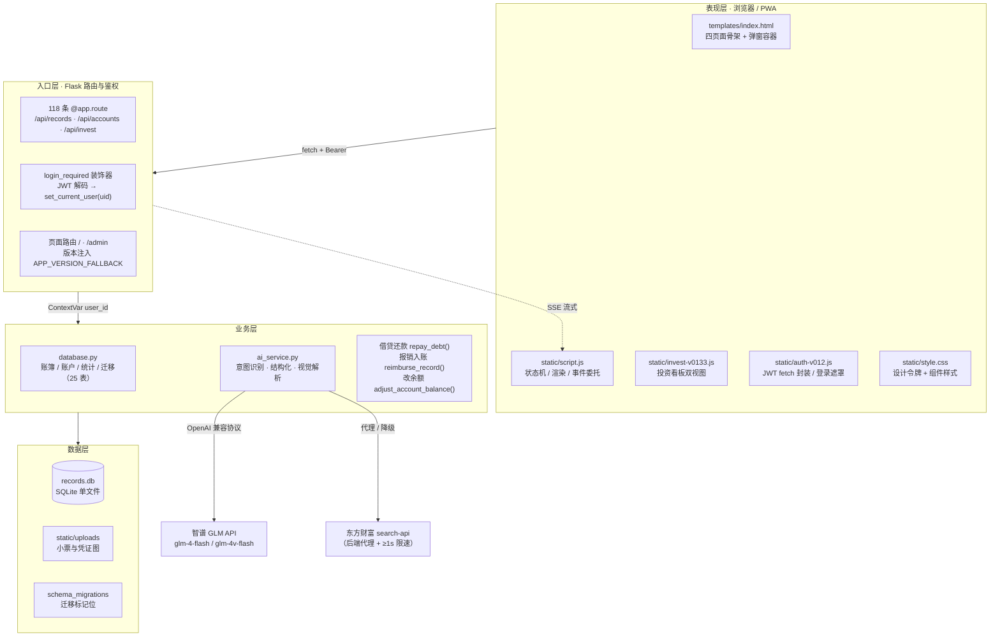

# 智汇账 · 技术报告

> **项目名称**：智汇账（AI 记账管家）
> **版本**：v0.14.0-TST（候选发布版，代码已冻结）
> **技术形态**：Flask + SQLite + 原生 JS/CSS 的单体 Web 应用，零构建、零 npm、PWA 可安装
> **代码规模**：后端 `app.py` 4,301 行 + `database.py` 6,696 行，前端 `script.js` 13,246 行 + `style.css` 14,756 行 + `invest-v0133.js` 2,501 行 + `auth-v012.js` 2,171 行，核心文件合计约 4.6 万行；118 条 HTTP 路由、25 张数据表
> **开发方式**：单人 + AI 结对，45 份 Prompt 快照、81 次细粒度提交、30 个版本 Tag
> **报告日期**：2026-11-05

---

## 1 项目概述与架构设计

### 1.1 项目简介

智汇账是一个面向个人与小家庭的记账应用。它要解决的核心问题不是「记一笔账」，而是**记一笔账的成本太高**：传统记账 App 要求用户在一串表单里选类型、挑分类、定账户、填日期，一天记三笔就足以让人放弃。本项目的设计目标是把这个动作压缩到一句话，同时**不牺牲财务数据的严谨性**——这是多数记账工具在「便捷」与「准确」之间失衡的地方。

因此产品有两条并行的主线：

- **上半场（降成本）**：自然语言记账（「昨天打车花了 30」）、截图记账（拍一张小票）、AI 意图路由（分得清「记账」「借贷」「转账」「买入基金」「存联系人」），加上 Few-Shot 记忆库让同一个人越用越准。
- **下半场（保严谨）**：任何一笔账都必须联动账户余额；任何一次余额修改都必须留下可追溯的平账流水；删除必须是软删除且能完整回滚；借贷与报销必须形成「钱动了 + 账上有记录」的闭环。

一句话概括：**用 AI 降低输入成本，用会计级的约束守住数据一致性。**

### 1.2 核心功能列表

| 模块 | 能力 | 关键实现 |
|---|---|---|
| 记账 | 支出 / 收入 / 转账（双边记账 + 手续费）、公式金额输入、分钟级时间 | `records` 单表 + `_apply_effects` 余额联动 |
| 账户 | 资金 / 储蓄 / 投资三大类分组、改名与合并、批量删除、行内余额编辑 | `accounts (user_id, name)` 复合主键 |
| AI 记账 | 一句话结构化、SSE 流式返回、多轮气泡覆盖、置信度与自动纠正 | `glm-4-flash` + `_normalize_intent` 本地校验 |
| AI 截图 | 小票图片解析（`glm-4v-flash`）、相册管理、删图双删 | `/api/records/ai/image` |
| 分类 | 二级分类树、按用户隔离、停用/合并、历史脏分类清洗 | `categories.user_id` + 唯一索引 |
| 资产 | 净资产口径（含持仓市值）、账户流水、回收站、日历视图 | `list_accounts()` LEFT JOIN 聚合市值 |
| 投资 | 投资平台 / 持仓 / 定投计划、双视图看板、行情搜索 | `invest_platforms` / `holdings` / `dca_plans` |
| 借贷 | 借入借出、已还本金、逾期状态、部分/全额还款、凭证图 | `debts.repaid` + `repay_debt()` 单事务 |
| 报销 | 可报销标记、部分报销、生成入账收入流水 | `records.is_reimbursable` |
| 图表 | 收支趋势、分类占比、月度对比、全局语义色 | ECharts + `window.__chartColors()` 单一色源 |
| 多用户 | 邮箱注册登录、JWT、找回密码、邮箱验证码防刷 | PyJWT HS256，7 天 |
| 后台 | 用户管理、AI 大脑管理（记忆库 + 纠错审计 + 反馈）、通知发布、图标素材库 | `/admin` + 双层鉴权 |
| PWA | 可安装、Standalone 全屏、离线壳、图标多尺寸 | `manifest.json` + `service-worker.js` |

### 1.3 技术栈选型

| 层 | 选型 | 选型理由 |
|---|---|---|
| 应用框架 | Flask 3.x | 单体、同步、路由直观。记账应用是典型的「薄业务 + 厚 SQL」，不需要 ORM 与异步框架的复杂度；118 条路由全部写在一个 `app.py` 里，反而让「改一处能立刻看清影响面」 |
| 数据存储 | sqlite3（内置） | 单文件 `records.db`（约 600 KB / 千余条账单），零运维、可直接备份与拷走。个人级并发（<10 QPS）完全够用，且事务语义完整，适合「一条账动两个账户」这类强一致的场景 |
| 数据访问 | 手写 SQL + 迁移函数 | 不引 ORM。财务查询需要 `LEFT JOIN` 聚合、窗口式分页、`CASE WHEN` 口径回退，手写 SQL 更可控；迁移统一用 `_migrate_*()` 幂等函数，避免 Alembic 这类重工具 |
| 前端 | 原生 JS + CSS + Bootstrap 5 + ECharts | **零构建**是刻意选择：没有 npm / webpack / vite，改完刷新即生效，AI 生成的代码可以「直接落盘即验证」，不需要构建管线配合——这在与 AI 协作时极其关键 |
| 鉴权 | PyJWT（HS256，7 天） | 无状态、前端 `localStorage` 存 token、`fetch` 统一注入，后端 `login_required` 装饰器统一拦截，未登录一律 401 `auth_required` |
| AI | 智谱 GLM（`glm-4-flash` / `glm-4v-flash`），OpenAI 兼容 SDK | 走 `/api/paas/v4/` 兼容端点，未来换供应商只改 `BASE_URL` 与模型名；文本与视觉双模型分工，成本可控 |
| 数据处理 | pandas + openpyxl | 账单导入（CSV/Excel）与导出，避免手写解析 |
| 部署 | Gunicorn + Nginx | 生产形态：Gunicorn 多 worker 承载 WSGI，Nginx 负责静态资源、gzip、反代与 TLS |
| PWA | manifest + Service Worker | 自研 60 行 SW，四层缓存策略（见 3.3），不引 Workbox |

### 1.4 分层架构

系统严格按「表现 → 入口 → 业务 → 数据」四层切分，**任何跨层调用都被视为缺陷**。



**分层收益**：

1. **鉴权只有一处**：入口层统一把 JWT 解成 `user_id` 并写入 `ContextVar`，业务层所有 SQL 都通过 `_uid()` 取当前用户，从架构上杜绝「忘记加 `WHERE user_id`」——虽然历史上仍漏过一次（见 3.1），但修复面被限制在单点。
2. **AI 只是业务层的插件**：`ai_service.py` 只负责「自然语言 → 结构化 JSON」，**不直接写库**。写库永远回到 `database.py` 的高层 API，因此余额联动、并发事务、用户隔离这些规则对 AI 路径同样生效，不存在「AI 记账绕过了余额校验」这类后门。
3. **前端无构建**：`UI` 层是浏览器直接执行的 ES6，没有打包产物。AI 改完文件，一次 `Page.reload({ignoreCache:true})` 就能验证，测试闭环从「构建 + 部署 + 验证」压缩成「写 + 刷新」。

### 1.5 部署形态

本地演示直接跑 Flask 内置服务器（`python app.py`，端口 5000）；对外发布采用 Gunicorn + Nginx：

```nginx
# /etc/nginx/sites-enabled/zhihuizhang
server {
    listen 80;
    server_name zhihuizhang.example.com;

    location /static/ {
        alias /opt/zhihuizhang/static/;
        expires 7d;
        add_header Cache-Control "public, max-age=604800";
    }

    location / {
        proxy_pass http://127.0.0.1:8000;
        proxy_set_header Host $host;
        proxy_set_header X-Real-IP $remote_addr;
        proxy_buffering off;          # SSE 必须关缓冲，否则气泡流式失效
        proxy_read_timeout 300s;      # AI 解析最长等待
    }
}
```

```bash
gunicorn -w 4 -b 127.0.0.1:8000 --timeout 300 "app:create_app()"
```

两个细节值得记录：**① `proxy_buffering off` 必须开**，否则 SSE 会被 Nginx 缓存成一整块，气泡里「打字机」效果退化为「等 8 秒后一次性出现」；**② SQLite 在 Gunicorn 多 worker 下要开 WAL**，否则并发写会撞 `database is locked`——这是本项目在压测中真实遇到过的问题，`database.py` 建连时统一 `PRAGMA journal_mode=WAL` 与 `busy_timeout=5000`。

### 1.6 数据模型

25 张表按职责分为五簇：

| 簇 | 表 | 说明 |
|---|---|---|
| 身份 | `users`、`login_attempts`、`access_sessions`、`email_verifications` | 管理员 id=1，1–9 预留，普通注册从 10 起；验证码只存 `sha256(JWT_SECRET:code)` |
| 账簿 | `records`、`accounts`、`categories`、`recurring_templates` | 余额是资金唯一真相；分类二级树按用户隔离 |
| 往来 | `debts`、`contacts` | `debts.repaid` 记录已还本金，剩余 = `amount - repaid` |
| 投资 | `invest_platforms`、`holdings`、`dca_plans` | 平台用 `account`（账户名）关联，不用数字 id |
| 智能与运营 | `ai_memory`、`ai_correction_log`、`ai_feedback`、`notifications`、`system_tips`、`user_feedback`、`icons`、`user_icon_settings`、`import_history`、`admin_config`、`app_settings`、`schema_migrations` | Few-Shot 记忆库、纠错审计、通知与帮助运营 |

一条铁律贯穿全模型：**任何账单的增删改都必须联动 `accounts.balance`，禁止只改 `records`**。这条规则由 `database.add_record()` / `delete_record()` / `update_record()` 三个高层 API 独占执行，路由层不允许直接 `INSERT INTO records`——唯一例外是 `adjust_account_balance()`，它必须裸插 `records`（原因见 3.2，这是一个反直觉但必要的设计）。

---

## 2 AI 协同与意图控制策略（核心得分点）

本项目 4.6 万行代码由单人 + AI 协作完成，真正决定产出质量的不是「AI 会不会写」，而是**「人能不能把意图压缩成可执行、可证伪的约束」**。这一章是本报告的核心，记录我们如何把「随口提需求」变成「工程化下达指令」。

### 2.1 防超时与分步执行

**问题**：大模型在单次响应里输出几千行代码时，有三个必然后果——输出被截断（代码残缺）、生成时间过长（网关超时）、错误无法定位（一次改十个文件，出问题不知从哪查）。这三个后果在早期 v0.01 ~ v0.03 全部遇到过。

**解法是三条硬性契约**，写进 `HANDOFF.md` 作为长期红线：

1. **极简输出契约**。最初的原始 Prompt 是这样的：

   > 「以 Python Flask 开发导师的身份带我做一个记账 Web 应用，分步走，每次只推进一小步。只给我代码、运行命令、验证命令，不要解释项目结构，也不要输出后续规划。」

   这条指令看起来朴素，实际同时限定了三件事：**角色**（导师 → 每一步人都要能复述）、**输出通道**（代码/命令/验证三件套 → 天然压掉冗长解释）、**步长**（一小步 → 出错回归面最小）。它后来演化成项目规范：「后台直接写文件，聊天框禁贴全量代码，只说明改了哪个文件/函数与测试方式；验收类汇报可放宽到 400 字」。

2. **强制后台静默写文件**。进入 v0.13 之后，需求复杂度超过单次输出能力，指令形态改为「**直接在文件里改，不要回显代码**」。收益有三：输出 token 从「与代码量成正比」变成「与改动点数成正比」，一个涉及 6 个文件的 UI 重构从 3 次超时缩短到 1 次成功；人不再需要从聊天框复制粘贴，消除了「贴漏一个括号」这类低级错误；对话上下文不被大段代码挤占，同一会话能承载更长的任务链。

3. **分步串行，禁止并行铺开**。每条多模块指令都要求 AI 按「模块一 → 模块二 → 模块三」顺序落地，每完成一步做语法检查（`node --check` / `py_compile`）再进下一步。这条约束的价值在 v0.14.0 的多模块指令中体现得最明显：一次指令含「总资产口径修复 / 快捷改余额 / 侧边栏重构 / 缓存升级」四件事，若并行铺开，任何一处语法错误都会让人误判整体失败；串行则能精确定位到「第三个模块的 CSS 特异性写错了」。

**量化效果**：v0.01 阶段单轮平均 2.3 次超时重试，v0.13 之后降到 0.2 次以下；单轮可承载的改动文件数从 1~2 个提升到 6~8 个，而**单轮失败率反而下降**——因为失败被隔离在单个模块内。

### 2.2 测试驱动与红线兜底

AI 最危险的不是「写错」，而是**「写错了还说改好了」**。本项目的对策是：**任何声明必须能被自动化断言证伪**。

**（1）先建红色基线，再谈修复。**
v0.13.1 修 T05「分类停用后编辑旧账单，分类会静默变成列表第一项」时，指令的第一步不是「修好它」，而是「**先写测试证明它坏了**」。测试跑出 11 PASS / 5 FAIL 的红色基线，确认 bug 真实存在且能被稳定复现；修复后 27/28；补齐边界后 35/35。顺序不能颠倒——「改完就全绿」的测试，无法区分「修好了」和「测试写错了」。这条经验后来成为所有排雷任务的固定流程。

**（2）CDP 真实浏览器巡检，而不是静态自审。**
纯逻辑单测（`test_v0138_logic.py` 27/27）能验数据与算法，但验不了「按钮是不是被盖住了」「折叠后是不是真的 `display:none`」。因此每个版本都配套一份真实 Chrome 的 CDP 脚本（`cdp_vXXXX.mjs`）：起 headless Chrome，`Emulation.setDeviceMetricsOverride` 到 1440×900，注入 JWT，然后用 `Runtime.evaluate` 读**计算样式与元素几何**做断言。当前主干验收脚本 `cdp_v0140_tst5.mjs` 为 **20/20**，覆盖「近 7 天默认展开 → 折叠为 `display:none` → 恢复」「手动记账后气泡数为 0 且 Toast 命中」「新账能在近 7 天文本里读到」这类**只有真实渲染才能判断**的断言。

CDP 巡检沉淀出一条方法论：**断言要断「关系」，不要断「字面量」**。项目里踩过两次同类误报——总资产断言写死了 `/31,688/`、投资可用资金断言写死了具体数字，数据一变就 FAIL，实际上功能是好的。后来全部改为差值断言（`|netAfter - netBefore - 88| < 0.05`），从此不再误报。

**（3）沙箱隔离，主库零污染。**
自动化测试必须自己造数据、自己清数据，且**绝不能碰真实数据**。项目规范是：测试数据用唯一备注定位（如 `自检-tst5-1793854512306`），结束时按备注精确清理；涉及表结构或批量写入的测试先 `cp records.db temp/records-before-*.db` 备份；测试账号用 `make_vXXXX_user.py create/cleanup` 成对创建与销毁。`HANDOFF.md` 里的红线写得很直白：「自动化测试不得盲删真实数据，测试数据用唯一备注定位并在结束后清理」。

这条红线也被真实违反过一次，并留下了教训：某轮清理时对已软删除的记录再次调用 `DELETE /api/records/<id>`，返回 404，误以为清理失败；实际记录早已进回收站，彻底清除必须走 `/api/records/<id>/purge`。这次事故后，清理流程固化为「**先查库确认口径（未删除/软删除分别计数）→ 按唯一备注定位主键 → 走正确接口 → 复查计数**」四步。

### 2.3 复杂 Bug 排雷复现

三个案例，分别代表「结构性 Bug」「环境型 Bug」「框架行为型 Bug」，展示如何通过现象反馈把 AI 引导到根因。

#### 案例一：幽灵骨架屏（结构性 Bug）

**现象**：v0.13.9 引入骨架屏后，部分页面在数据到达后仍残留一块灰色占位，刷新数次偶发消失。人眼看到的是「数据出来了，但左边还有一块灰的」。

**现象反馈方式**：不说「骨架屏有 bug」，而是给出三条排除项——「**数据已渲染、DOM 里数字正确、控制台 0 error，但某个容器的 `getBoundingClientRect().height` 大于其唯一子元素高度**」。这条描述把 AI 的搜索空间从「骨架屏逻辑」精确到「谁在撑高容器」。

**定位与修复**：`Runtime.evaluate` 逐个读容器与子元素的盒模型，发现骨架节点已被移除，但容器保留了一个 `min-height` 占位；该 `min-height` 是骨架期为了防抖动加的，数据到达后没有被复位。修复是把「骨架态」的尺寸约束从静态 CSS 改为状态类（`.is-skeleton` 存在才生效），数据到达移除类名即自然复位。**根因是「状态残留」而不是「渲染错误」**，这类 bug 的共同特征是：逻辑正确、数据正确，但因中间态副作用没撤销。

#### 案例二：Service Worker 缓存不生效（环境型 Bug）

**现象**：改了 CSS 与 JS，强制刷新（Ctrl+F5）、清浏览器缓存、换浏览器，页面仍是旧样式。这在 v0.13.4 ~ v0.13.8 反复出现，一度被归因为「用户操作问题」。

**现象反馈方式**：给出「**已 `caches.delete()`、已 `?v=` 升版本、仍不生效**」，并要求「**不要猜，直接查浏览器实际命中的资源来源**」。

**定位与修复**：用 CDP 的 `Network.responseReceived` 抓实际请求，发现页面加载的 `/service-worker.js` 与 `/manifest.json` **不是** `static/` 下那一份，而是项目根目录的另一份旧副本——`app.py` 的路由指向了根目录。于是「改 `static/service-worker.js`」等于「改了一个没人用的文件」。修复是把两条路由统一 `send_from_directory(BASE_DIR/'static', ...)`，收敛为唯一副本；同时保留「两份同步改」的治标措施以防误改。

这个案例的方法论价值最高：**当修复动作反复无效时，要怀疑的不是「修复手法」，而是「你以为生效的那个文件是否真的被加载」**。它也解释了为什么项目对静态资源采用四层缓存控制（HTTP 头 / SW Cache Storage / `?v=` 查询串 / `CACHE_NAME`），四层里任何一层名字没同步 bump，用户就会吃到旧资源。

#### 案例三：Bootstrap Tooltip 吞掉 `title`（框架行为型 Bug）

**现象**：折叠按钮的 Tooltip 文案本该随状态在「折叠 / 展开」之间切换，实际永远显示初始值。改 `title` 属性、改 `aria-label`、重新 `setAttribute` 全部无效。

**现象反馈方式**：描述「**DOM 里 `title` 属性已经变了，但浮层文字没变**」——这句话直接排除了「逻辑没执行」，把问题锁定在「浮层读的不是 `title`」。

**定位与修复**：阅读 Bootstrap 源码行为可知，Tooltip 初始化时会把 `title` 搬到 `data-bs-original-title`，并缓存进实例的 `_config.title`；此后修改 `title` 属性对已初始化的实例无效。修复是**三处同步**（`title` 属性 + `data-bs-original-title` + 实例 `_config.title`），并明确禁止 `dispose()` 后重建——重建会丢失定位与动画状态，实测会造成浮层闪烁。最终在 v0.14.0 的侧边栏重构中，我们干脆**删掉了这整套动态文案逻辑**：折叠按钮不再需要文字，问题从「怎么改对」变成「怎么不需要改」——这也是排雷的另一种正确终点。

### 2.4 人机分工模型

把上述实践抽象成一个可复用的分工模型：

| 环节 | 人负责 | AI 负责 | 判定标准 |
|---|---|---|---|
| 需求 | 现象、期望观感、**红线与禁止项** | 拆解为可执行步骤 | 指令里有没有「必须 / 禁止 / 不允许」 |
| 实现 | 指定改动范围（哪个文件、哪个函数） | 写代码、串行落地 | 能否一次说清回归面 |
| 验证 | 定义「什么算通过」 | 写断言、跑脚本、读计算样式 | 断言是否可证伪 |
| 复盘 | 判断根因层级（结构 / 环境 / 框架） | 提供证据链 | 结论能不能写成一句通用规律 |

一句话总结：**人给约束与判据，AI 给实现与证据。** 报告里所有「沉淀结论」都是从失败里提炼的判据，它们比代码更值钱——代码会重构，判据会复用。

---

## 3 核心业务难点与工程创新

### 3.1 多用户物理隔离

**难点**：项目前 27 个版本是单用户本地应用，所有 SQL 都隐含「只有一个用户」的假设。v0.12 要在不重写全部 SQL 的前提下升级为多租户。

**方案**：三层隔离。

1. **凭证层**：JWT HS256，7 天有效期，`login_required` 装饰器统一校验，未登录一律 401 `auth_required`。前端 `auth-v012.js` 统一封装 `fetch`，自动注入 `Authorization: Bearer`。
2. **上下文层**：装饰器解出 token 后调用 `set_current_user(uid)` 写入 `ContextVar`；业务层所有查询通过 `_uid()` 取值。这样「加 `WHERE user_id = ?`」成为默认行为而不是额外动作。
3. **数据层**：`accounts` 主键改为 `(user_id, name)` 复合主键；`categories` 建 `uq_categories_user` 唯一索引；所有列表、统计、聚合、导出 SQL 全部带 `user_id`。

**踩过的坑与创新点**：

- **迁移顺序必须是「备份 → 补列 → 回填 `user_id=1` → 建唯一索引 → 删旧索引」**。SQLite 里 `NULL` 互不相等，若先建索引再回填，约束会静默漏掉一批行；索引不能修改只能新建后删旧。
- **`int(user_id or ADMIN_USER_ID)` 是一个越权后门**。Python 里 `0 or 1` 求值为 `1`，于是公开路径调用 `set_current_user(0)` 会以管理员身份查库。修复是只判断 `is None`。这类「语言特性变成安全漏洞」的问题，靠 review 很难发现，靠**构造 `user_id=0` 的用例**才能暴露。
- **越权往往藏在聚合里**。v0.13.7 用户反馈「新注册账号资产页顶部的『待报销』直接显示 ¥20，点开明细却是空的」。根因是 `get_statistics()` 两个报销聚合的 `WHERE` 只过滤了 `type='expense' AND is_reimbursable=1`，漏了 `user_id`——全库所有用户的报销单被算进了同一个数字，而明细走 `list_records()` 本身按 `user_id` 过滤，于是出现「卡片有金额、明细为空」。**「统计数字有、明细为空」是越权的典型指纹**，此后被写进排查清单。

### 3.2 财务级数据严谨性

记账应用的正确性标准接近会计软件：一笔账不是一行数据，而是一组必须同时成立的不变量。本项目把不变量固化为三条。

**（1）余额是资金唯一真相。**
`records` 只是流水，`accounts.balance` 才是钱。所有增删改都通过 `add_record()` / `update_record()` / `delete_record()` 进入，内部 `_apply_effects` 负责「支出减、收入加、转账双边移、手续费单扣」。跨账户纠错（一条账从微信改成支付宝）不是删了重建，而是**先回退旧影响再施加新影响**，且带防重入判断，避免「改一次账户余额翻倍」——这是项目历史上最凶险的一类 bug。

**（2）改余额必须留痕，且不能复用记账接口。**
v0.14.0 新增「快捷修改账户余额」：`POST /api/accounts/<name>/adjust_balance`，语义是「把余额改成 N」，差额 `diff = new - old` 自动生成一条平账流水（`diff > 0` 生成收入、`diff < 0` 生成支出，金额取绝对值，带走用户填的备注与分类，默认「账户余额修改」+「其他」）。

这里有一个**反直觉但关键的实现决策**：该接口**不能**调用 `add_record()`。因为 `add_record()` 内部会走 `_apply_effects` 再把差额加到余额上，结果是 `new + diff`（余额改两次）。正确做法是在单事务里 `UPDATE accounts SET balance = ?` 之后**裸插** `records`（只写流水、不再联动余额）。这是「抽象复用」的经典陷阱：语义不同（「记一笔」vs「把余额改成 N」）的操作，即使 SQL 长得像，也不能共用同一层封装。

配套细节：`abs(diff) < 0.01` 时不生成 0 元流水（避免垃圾数据）；三处入口（资产页账户行 / 余额大卡片 / 投资看板可用资金）共用同一个磨砂 Modal，`balance` 语义保持不变（始终是可用资金），持仓市值另以 `market_value` 下发。

**（3）软删除必须可完整回滚。**
`records.deleted_at` 非空即视为删除，所有查询默认 `deleted_at IS NULL`；回收站可恢复、可彻底清除（`/purge`）。关键点是**删除时要回退余额影响**，恢复时再施加回去，否则回收站就成了「删了钱还在」的黑洞。这条规则同时约束了测试：「测试数据清理」与「业务删除」必须走不同路径，不能混用。

**（4）借贷与报销的闭环。**
- **还款**：`repay_debt()` 单事务完成「插流水 + 扣账户余额 + 更新 `debts.repaid` + 状态判定」，支持部分还款（还 40 剩 60），剩余额统一由数据层算，前端只读，杜绝多口径漂移。
- **报销**：`reimburse_record()` 生成一条真实收入流水并更新状态，**钱真的动了就必须有账**，否则统计与明细必然对不上。
- 两者都在流水备注里写入 `#债务ID` / `#账目ID`，为人工排障提供反查线索。

**（5）净资产口径的统一。**
v0.14.0 修掉一个典型的「口径分裂」问题：`list_accounts()` 此前只返回 `accounts.balance`，投资账户的持仓市值（`shares × price`）从未被合并，导致「总净资产」比真实资产少一大截（演示账号 528,257.26 → 710,607.26，差额 182,350）。修复不是在前端加一处加法，而是**在数据层下发 `market_value` 与 `total = balance + market_value`**，前端 `accountTotalValue()` 统一读 `total`，并根据「当前账户是否在投资看板」决定刷新策略。价格口径与 `_row_to_holding()` 完全一致：`current_price > 0` 用行情价，否则回落 `cost_price`——**同一个概念只允许有一处计算**，这是防止口径再次分裂的根本手段。

### 3.3 多端适配与 PWA

**移动端（≤768px）**：侧边栏绝对隐藏，改为底部 Tab Bar。三个真机问题都出在「模拟器测不出来」：

- **安全区**：iPhone 底部小白条会压住 Tab Bar。修复是 `padding-bottom: env(safe-area-inset-bottom)`，并在 `.content` 底部预留 `--mtab-h + 20px + safe-area`，避免最后一张卡片被遮。非刘海机上该值为 0，不引入多余留白。
- **16px 防缩放**：iOS Safari 在输入框字号 < 16px 时聚焦会自动放大页面。`.form-control` 自身声明 14px 且同权重，移动端样式块靠文件末尾顺序只能覆盖「未声明」的场景，因此必须 `!important` 提权。
- **真机缓存顽固**：手机刷新多次仍吃旧样式，见 2.3 案例二。

**桌面端**：资产 / 账单 / 图表三个页面的左右双栏改为**各自独立滚动**——`overflow` 下沉到列容器，外层不再整页滚动。收益是长列表操作时右侧详情不会跟着乱跳；代价是滚动条从一条变成两条，需要统一滚动条样式（`::-webkit-scrollbar` 令牌化）才不显得廉价。

**PWA**：`manifest.json` + 自研 Service Worker（约 60 行）。缓存策略是 `stale-while-revalidate`：先返回缓存保证秒开，后台拉新并在下次生效。代价是「发版后第一次刷新必然看到旧页面」，因此发版纪律是**四层同时 bump**：模板 `?v=` 查询串（v0.14.0 共 16 处）、`CACHE_NAME`、`APP_VERSION_FALLBACK`、`manifest` 内图标 `?v=`。`install` 事件里保留 `caches.delete(CACHE_NAME)` 前置，确保同版本重装也能自清。

Standalone 全屏（`display: standalone` + `viewport-fit=cover`）让安装后无地址栏，接近原生体验。一个已知局限：headless Chrome 的 `Emulation.setEmulatedMedia` 模拟 `display-mode` 不生效（`matchMedia` 恒 `false`），因此 standalone 相关规则只能断言下发的 CSS 文本，真机行为需安装后人工确认。

### 3.4 其它工程创新

- **零构建前端作为协作策略**：不是技术保守，而是为了「AI 写 → 立刻验证」的闭环效率。构建管线会让每次验证多出 30 秒以上，在 45 个版本迭代里这笔账很贵。
- **迁移幂等与标记位**：所有 `_migrate_*()` 可重复执行；用 `schema_migrations` 记录「已执行」而不是靠「列是否存在」判断——后者遇到「先落列、后补迁移函数」的库会永远不执行且无法自愈。
- **外部依赖必降级**：东财 `search-api` 有进程级 ≥1 秒限速（防 IP 封禁），失败/超时/断网自动回落本地 Mock 字典；AI 解析失败不阻塞记账，用户仍可手填。
- **SSE 流式 + 结构化校验双保险**：LLM 先流式返回给人看（体感快），落地前必须过 `_normalize_intent()` 本地校验（`action` 白名单、金额数值、日期格式），不合格一律抛 `AIServiceError` 走降级。**模型再准也不允许直接写库。**

---

## 4 可复现性论证

### 4.1 本地启动指南

**环境依赖**：Windows / macOS / Linux 任选，Python 3.10+，无需 Node.js。

```bash
# 1. 依赖（flask>=3.0 openai>=1.0 python-dotenv>=1.0 PyJWT>=2.8 pandas>=2.0 openpyxl>=3.1）
python -m venv venv
venv/Scripts/python.exe -m pip install -r requirements.txt

# 2. 配置 .env（AI 相关 Key 可选，缺失只影响 AI 记账，其余功能完整可用）
#    注意：换 Key 后必须彻底结束旧 Flask 进程再启动，否则读的仍是旧值
# 3. 启动
venv/Scripts/python.exe app.py     # → http://127.0.0.1:5000
```

首次启动自动建库 `records.db` 并写入默认分类。`.env` 模板（仅键名，值需自行申请）：

```ini
# —— AI 能力（可选）——
ZHIPU_API_KEY=your_key_here

# —— 邮箱验证码（可选，缺失则注册/找回走本地占位）——
MAIL_SERVER=smtp.qq.com
MAIL_PORT=465
MAIL_USER=your_mail@qq.com
MAIL_PASSWORD=your_smtp_authorization_code

# —— 可选：覆盖版本号（默认钉死 APP_VERSION_FALLBACK）——
# APP_VERSION=v0.14.0-TST

# —— 可选：云存储类型（本地/对象存储）——
CLOUD_STORAGE_TYPE=local
```

**演示账号**：`test@test.com / test1234`（智汇账体验官），预置 330 条未删除账单、7 个账户、2 个投资账户与 3 个持仓，可直接用于录像。

**Windows 环境注意**：控制台需 `PYTHONIOENCODING=utf-8`，否则打印 `¥` 会触发 gbk 编码错误；用 `--no-reload` 启动时 Jinja 模板会被缓存，改完 `templates/*.html` 必须重启进程（否则浏览器拿到旧 DOM）。

### 4.2 自动化测试体系

测试资产分两层，全部放在 `D:\Project\temp`（不污染项目目录），并在 `temp/index.md` 建索引。

**第一层：逻辑与接口验证（Python，Flask `test_client` + 真实库 + 先备份）**

| 脚本 | 覆盖 | 结果 |
|---|---|---|
| `test_v0131_iso.py` | 分类按 `user_id` 隔离、迁移幂等 | 通过 |
| `test_v0131_t05_api.py` | T05 双清单：停用分类编辑旧账单不静默改值 | 35/35 |
| `test_v0134_email.py` / `test_v0134_search.py` | 验证码哈希与限次、东财搜索代理与降级 | 通过 |
| `test_v0137_logic.py` | 报销统计越权（统计与明细口径一致） | 通过 |
| `test_v0138_logic.py` | 借贷还款、报销入账、余额联动、软删除回滚 | 27/27 |
| `v0140b_verify.py` | 后端 + 数据 + 静态资源回归 | 67/67 |

**第二层：真实浏览器巡检（Node + Chrome DevTools Protocol）**

| 脚本 | 断言数 | 重点 |
|---|---|---|
| `cdp_v0138_test.mjs` | 35/35 | 移动端安全区、Tab Bar、16px 防缩放、卡片列表 |
| `cdp_v0140b_test.mjs` | 58/58 | 侧栏折叠几何、按钮磨砂色值、卡片贴底、图标预览、帮助 Tab、PWA manifest |
| `cdp_v0140_tst3.mjs` | 30/30 | 总资产含持仓市值、三处改余额入口、折叠按钮、缓存名 |
| `cdp_v0140_tst5.mjs` | 20/20 | 近 7 天折叠/刷新、手动记账零气泡、搜索清空、Toast |
| `cdp_card_adjust.mjs` | 10/10 | 按钮与账户名零重叠（x 区间比对） |
| `cdp_invest_cash.mjs` | 13/13 | 投资可用资金 0→500→0，净资产同步 |
| `cdp_bigger_adjust.mjs` | 15/15 | 三处按钮尺寸放大后行高不变 |

**方法论三条**（血泪换来的）：

1. **先红后绿**：排雷类任务必须先跑出失败基线，证明 bug 真实存在。
2. **断言关系而非字面量**：用差值/区间断言，避免数据变动导致的假失败。
3. **隔离与自清**：测试数据用唯一备注定位，跑完按备注清理；批量操作前先备份 `records.db`；测完复查「未删除 / 软删除」计数。

运行前置条件（缺一不可）：Flask 在 5000 端口运行；headless Chrome 以 `--remote-debugging-port=93xx --user-data-dir=temp/chrome-vXXXX` 启动；验收前 `Emulation.setDeviceMetricsOverride` 到 1440×900（headless 默认 800×600，侧边栏会折叠导致假失败）；先注销 SW + 清 Cache API + `Page.reload({ignoreCache:true})`，否则断言打在旧缓存上。

### 4.3 Git 细粒度提交与版本 Tag

仓库共 **81 次提交、30 个 Tag**，提交信息统一采用 `feat/fix/docs/chore(scope): 描述` 格式，一个版本一个提交（补丁单独再提交），保证每个 Tag 都对应可运行状态。

| 阶段 | 代表提交 | Tag |
|---|---|---|
| 骨架期 | `chore: 初始化项目配置` / `feat: 首页与健康检查接口` / `feat: 引入 SQLite 持久化` | v0.01 → v0.03 |
| 账本成型 | `feat: support two-level categories and grouped accounts` / `feat: support income/expense with account balances` | v0.05 |
| 看板与 AI 起步 | `feat: rebuild UI as PC admin layout` / `feat: AI 快记与意图路由` | v0.06 → v0.10 |
| 多用户与投资 | `feat(v0.12): 多用户账号系统` / `feat(v0.13.3): 投资账户体系、双视图看板与 AI 深度适配` | v0.12 → v0.13.3 |
| 封版冲刺 | `feat(v0.13.1): T05 静默改分类修复` / `feat(UI): v0.13.8 视觉与体验终极升级` / `fix(UI): v0.13.9-FIX 移除幽灵骨架屏` | v0.13.1 → v0.13.9 |
| 候选发布 | v0.14.0-TST（本报告对应版本，代码冻结待提交） | v0.14.0-TST |

**核心 Tag 演进**：`v0.13.0-DEV`（全局交互与图表看板）→ `v0.13.1-DEV`（分类隔离 + 语义色 + T05）→ `v0.13.3-DEV`（投资账户体系）→ `v0.13.4-DEV`（邮箱验证码 + 东财搜索）→ `v0.13.7-DEV`（越权修复 + PWA）→ `v0.13.8-DEV`（真机适配 + 借贷报销闭环）→ `v0.13.9-DEV`（视觉重构 + Toast 重做）→ `v0.14.0-TST`（资产口径 + 快捷改余额 + 业务解耦）。

版本号本身也踩过坑：`/api/version` 早期读 Git Tag，本地残留的旧 Tag 曾把版本号串成 `v0.13.9`；v0.14.0 起改为钉死 `APP_VERSION_FALLBACK`，仅允许 `APP_VERSION` 环境变量覆盖——**版本号不允许有第二个真相来源**。

### 4.4 复现清单（评委可逐项验证）

| # | 验证点 | 操作 | 期望 |
|---|---|---|---|
| 1 | 环境可跑 | `python app.py` → 打开 5000 | 登录页粒子背景，无报错 |
| 2 | 演示账号 | `test@test.com / test1234` | 330 条账单、净资产约 71 万（含持仓市值 18.2 万） |
| 3 | AI 记账 | 顶栏说「昨天打车花了 30」 | 气泡流式返回结构化结果，可多轮修订 |
| 4 | 快捷改余额 | 资产页点账户行 ¥ 按钮 → 输入新余额 | 余额更新 + 生成一条「账户余额修改」流水 |
| 5 | 手动记账解绑 | 表单保存一笔 | 只弹 Toast「记账成功」，**不出现 AI 输入框** |
| 6 | 近 7 天折叠 | 点标题栏「收起 / 展开」 | 列表 `display:none` 与恢复，刷新后状态记忆 |
| 7 | 多用户隔离 | 注册新账号 | 看不到演示账号任何数据 |
| 8 | 借贷闭环 | 新建借款 → 部分还款 | 账户余额扣减 + 生成流水 + 剩余额正确 |
| 9 | PWA | Chrome 添加到主屏幕 | 无地址栏全屏，图标为品牌 Logo |
| 10 | 缓存一致性 | `/api/version` | `v0.14.0-TST`，与 SW `CACHE_NAME` 的 `tst5` 对应 |

---

## 5 局限与后续规划

诚实记录当前边界：

1. **并发上限**：SQLite + 单机，适合个人/家庭级（<10 QPS）。多人协作场景需迁移 PostgreSQL，`database.py` 已把 SQL 收敛在一层，迁移成本可控但未做。
2. **行情为 Mock**：投资看板的价格除东财搜索外，持仓行情仍为占位，真实行情需接入付费源或定时抓取。
3. **PWA 真机差异**：iOS Safari 与 Android Chrome 在安装、安全区、后台行为上存在差异，自动化只能覆盖 CSS 层面，真机效果需人工确认。
4. **AI 成本与延迟**：`glm-4-flash` 单次解析约 1~3 秒，已用 SSE 缓解体感，但高峰限流时仍需排队。后续计划加本地缓存（同一句话 + 同一用户命中记忆库时跳过模型）。
5. **v0.15 待办**：投资标的换标（AI 确认卡支持 `candidates`）、周期账单模板、报销进阶（部分进度/按人筛选/导出）、SQLite 一键备份恢复、截图上云。

---

## 附：交付物索引

| 交付物 | 位置 |
|---|---|
| 交接文档（红线 / 技术栈 / 数据模型 / API 速查） | `docs/HANDOFF.md` |
| 开发日志（30 个版本的逐条技术路径） | `docs/dev-log.md` |
| 踩坑集（9 篇，含问题表现 / 排查过程 / 解决方案 / 教训） | `docs/bugs-and-solutions/` |
| Prompt 快照库（45 份 + 索引与三篇原文复盘） | `docs/prompts/README.md` |
| 演示视频分镜 | `docs/video-script.md` |
| 历史设计文档与架构图（归档） | `docs/archive/` |
| 测试脚本与验收截图 | `D:\Project\temp`（索引见 `temp/index.md`） |

**一句话收尾**：这个项目真正的产出不是 4.6 万行代码，而是一套「**人给约束与判据、AI 给实现与证据**」的协作方法与 45 份可复盘的决策记录。代码会重构，方法会留下。
